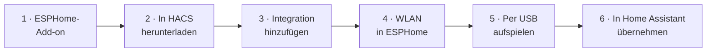

<p align="center">🇬🇧 <a href="https://github.com/Aggro600/ESPHomeRemote/blob/master/README.md">English</a> · <b>🇩🇪 Deutsch</b></p>

<p align="center">
  
</p>

<h3 align="center">Die Fernbedienung, die dein Smart Home verdient.</h3>

<p align="center">
  Touch-Display · Bluetooth · Infrarot · Sprache · eine Dockingstation, die alles verbindet.<br>
  Komplett im Browser eingerichtet, direkt in Home Assistant – <b>ohne Programmieren, ohne YAML-Gefummel</b>.
</p>

<p align="center">
  <a href="https://github.com/Aggro600/ESPHomeRemote/releases"></a>
  <a href="https://my.home-assistant.io/redirect/hacs_repository/?owner=Aggro600&repository=ESPHomeRemote&category=integration"></a>
  
  
  <a href="https://github.com/Aggro600/ESPHomeRemote/actions/workflows/tests.yml"></a>
  <a href="https://github.com/Aggro600/ESPHomeRemote/blob/master/LICENSE"></a>
</p>

<p align="center"><br>
<sub>Gerendert aus dem 3D-Modell der Hardware (<a href="https://github.com/LORDSn1per/OpenRemote-Hardware">OpenRemote Rev6</a>, GPL-3.0) – auf den Displays läuft diese Firmware.</sub></p>

<p align="center"></p>

<p align="center">
  <a href="#schnellstart"><b>▶ In 30 Minuten startklar</b></a> &nbsp;·&nbsp;
  <a href="https://aggro600.github.io/ESPHomeRemote/showcase/"><b>🧊 In 3D ansehen</b></a> &nbsp;·&nbsp;
  <a href="https://github.com/Aggro600/ESPHomeRemote/blob/master/CHANGELOG.md"><b>✨ Was ist neu</b></a>
</p>

---

<table>
<tr>
<td width="33%" valign="top">

### 🖱️ Ohne eine Zeile Code
Tasten, Menüs, Startseiten, Popups und Widgets – alles in einem durchdachten Konfigurator in der Seitenleiste
von Home Assistant, am PC und am Handy. Änderungen sind in Sekunden auf der Remote.

</td>
<td width="33%" valign="top">

### ⚡ Sofort da, selbst aus dem Schlaf
Die Dockingstation leitet Tasten, Befehle und den Stand per Funk weiter. Remote mit einer Taste wecken – die
Taste ist nach etwa **0,2 s** beim Dock, lange bevor das Display an ist.

</td>
<td width="33%" valign="top">

### 🔋 Wochen mit einer Ladung
Tiefschlaf mit klugem Wecken: hochheben, antippen oder irgendeine Taste. WLAN nur, wenn es wirklich nötig ist –
den Rest macht das Dock.

</td>
</tr>
</table>

---

## Eine Fernbedienung für alles

<p align="center"></p>

- **Fernseher, Streamer, Tablets und PCs per Bluetooth** – vier Geräte, umgeschaltet über *Aktivitäten* wie bei
  einer Harmony, als Tasten, **Maus (Touchpad)** oder **Tastatur**.
- **Infrarot für den Rest** – rund 270.000 Geräte aus der Flipper-IRDB und dem Logitech-Harmony-Archiv, dazu
  eigene, angelernte Codes.
- **Dein Smart Home auf dem Display** – Licht mit Reglern und Farben, Rollos, Sensoren, Kameras, Szenen,
  Klingel-Popups.
- **Sprachassistent** – Google am Fernseher oder Home Assistant Assist, mit eingebautem Mikrofon (auch übers Dock, das WLAN bleibt aus).
- **Durchsage** – Taste halten, sprechen, und es läuft mit Gong auf deinen Lautsprechern (z. B. einer Cast-Gruppe).
- **Dein Menü auf dem Fernseher** – dasselbe Kachel-Menü wie auf der Remote, eingeblendet auf jedem Android-TV-Streamer
  und bedient mit der Fernbedienung des Fernsehers. Dazu Kamera als Bild im Bild und Soundbar ein/aus per HDMI-CEC.
- **Bewegungsgesten** – schütteln, kippen oder eigene anlernen (Kreis, Wischen …).

## Alles im Browser einstellen

<p align="center"></p>

Die Seite **Fernbedienung** in der Seitenleiste von Home Assistant zeigt jede Remote und jedes Dock auf einen
Blick – Akku mit 24-Stunden-Verlauf, Verbindung, Firmware und Hinweise mit einem Knopf zum Beheben.

<table>
<tr>
<td width="50%"></td>
<td width="50%"></td>
</tr>
<tr>
<td valign="top"><b>Jede Taste, wie du willst</b> – Taste auf der virtuellen Remote antippen, Aktionen für kurz,
doppelt und lang anlegen: Bluetooth, Home Assistant, Infrarot, 433 MHz oder Funktionen der Remote. Je Aktivität
anders.</td>
<td valign="top"><b>Startseiten je Aktivität</b> – Uhr, Wetter, Medien, Timer, Kamera und Licht als Widgets im
Raster, mit einer Live-Vorschau, die genau wie das Display aussieht.</td>
</tr>
</table>

## Ein Smart Display im Dock

<p align="center"></p>

Stell die Remote ins Dock, und sie wird zum Display für Nachttisch oder Couchtisch: **Uhrzeit, Wetter,
Raumklima, Termine und Ladestand** – welche Teile und in welcher Reihenfolge, bestimmst du. Läuft Musik,
wechselt sie zum **Spektrum-Analyser**, auf Wunsch über dem Cover. Antippen zeigt eine **Steuerleiste**: zurück
zur Fernbedienung, Musik ⇄ Uhr, ⏮ ⏯ ⏭ – oder *Heute aus* (aus, bis du sie aus dem Dock nimmst).

## Apps öffnen – ganz einfach

<p align="center"></p>

Eine Taste, die Netflix öffnet? Öffne die App einmal am Fernseher – der Assistent **erkennt sie**, schlägt den
Namen vor und legt den Befehl an. Mit einem Klick testen. Genau dort, wo du ihn brauchst: im Tasten-Editor und
in jedem Menü oder Popup.

## Immer im Blick, wie gefunkt wird

<table>
<tr>
<td width="34%" align="center"></td>
<td width="66%"></td>
</tr>
<tr>
<td valign="top"><b>Schnelleinstellungen</b> zeigen den Funkweg live: Remote → Dock → Gerät, jede Strecke blau,
wenn sie steht, rot, wenn nicht. Getrennte Schalter für Dock-Betrieb, Bluetooth und WLAN.</td>
<td valign="top"><b>Übersicht je Remote</b> – Verbindung, Akku, Firmware und Abkürzungen zu allen Seiten.</td>
</tr>
</table>

## Die Dockingstation

<table>
<tr>
<td width="50%"></td>
<td width="50%"></td>
</tr>
<tr>
<td valign="top"><b>Die Zentrale</b> (ESP32-C3) – hält bis zu vier Bluetooth-Geräte verbunden, ist
<b>IR-Blaster</b> und <b>433-MHz-Sender</b> für Home Assistant und funkt alles für die Remote weiter.</td>
<td valign="top"><b>Licht, das dem Raum folgt</b> – Display, Tastenbeleuchtung und Dock-LED richten sich nach
einem Lichtsensor. Kurve ziehen; sie lernt mit, wenn du nachregelst.</td>
</tr>
</table>

## Noch mehr Highlights

<table>
<tr>
<td width="50%"></td>
<td width="50%"></td>
</tr>
<tr>
<td valign="top"><b>Menü-Editor</b> – Seiten, Unterseiten und Popups, die von selbst aufgehen (Klingel,
Sleeptimer, Bildmodus …). Eine Seite mit einem Klick an deine anderen Remotes schicken.</td>
<td valign="top"><b>Tabelle</b> – alle Aktivitäten und Folgemodi nebeneinander.</td>
</tr>
<tr>
<td></td>
<td></td>
</tr>
<tr>
<td valign="top"><b>Gesten</b> – eingebaute und eigene, erkannt egal wie du die Remote hältst.</td>
<td valign="top"><b>Suche (Strg K)</b> – findet jede Taste, Einstellung und Menüseite.</td>
</tr>
<tr>
<td align="center"> </td>
<td></td>
</tr>
<tr>
<td valign="top"><b>Am Handy</b> – der ganze Konfigurator, gemacht für kleine Bildschirme.</td>
<td valign="top"><b>Geste anlernen</b> – dreimal ausführen, fertig.</td>
</tr>
</table>

<details>
<summary><b>Alle Funktionen im Detail</b></summary>

**Fernbedienung**
- **Steuert Fernseher, Streamer, Tablets und PCs per Bluetooth** – 4 Geräte, Umschalten über „Aktivitäten“
  wie bei Harmony. Je Gerät wählbar: nur Tasten, **Maus (Touchpad)**, **Tastatur** oder beides.
- **Jede Taste frei belegbar** – kurz, doppelt und lang getrennt, je Aktivität anders, mit Halten und Wiederholen.
  Dazu Schritte **beim Starten/Beenden** einer Aktivität (TV an, Eingang wählen …).
- **Folgemodi** – nach einer Aktion gelten ein paar Sekunden andere Tasten (z. B. Kanal +/− dimmt die Lampe).
- **Bewegungsgesten** – zweimal schütteln, kippen, und **eigene Gesten anlernen** (Kreis, Wischen …):
  erkannt wird die Form, egal wie groß, schnell oder wie man die Remote hält.
- **Touchpad** – das Display wird zur Maus, mit Scrollstreifen, Klicktasten und Tastenkürzel-Makros.
- **Infrarot** – rund 270.000 Geräte aus der Flipper-IRDB und dem Logitech-Harmony-Archiv (bleiben per GitHub aktuell),
  eigene Codes **anlernen** und verwalten; senden über die Remote, das Dock oder andere IR-Sender in Home Assistant (Broadlink …).
- **Sprachassistent** – Google auf dem Fernseher oder Home Assistant Assist.

**Display & Smart Home**
- **Eigenes Menü** – Seiten, Kacheln, Licht-Regler, Rollos, Anzeigen, Kamerabilder im Raster frei anordnen,
  dazu **Popups**, die von selbst aufgehen („Es hat geklingelt“, Sleeptimer, Bildmodus bei Netflix …).
- **Smart Display im Dock** – steht die Remote im Dock, zeigt sie Uhrzeit, Wetter, Raumklima, Termine und Ladestand.
- **Helligkeit nach Lichtsensor** – Display, Tastenlicht und Dock-LED folgen dem Raumlicht; die Kurve lernt mit.
- **Kamera und Klingel** – Bild auf der Fernbedienung, Kamera auf dem Fernseher (vier Größen, fünf Lagen, mehrere Fernseher).
- **Menü auf dem Fernseher** – dein Kachel-Menü als Einblendung auf Android-TV-Streamern, dazu Soundbar ein/aus per HDMI-CEC.
- **Lange Akkulaufzeit** – Tiefschlaf, wacht auf beim Hochheben, Klopfen oder Tastendruck; die Weck-Taste und alles,
  was während des Starts gedrückt wird, kommt trotzdem an.

**Dockingstation (optional, ESP32-C3)**
- **IR-Sender für Home Assistant** – jedes IR-Gerät wird ein Media-Player, eine Remote-Entität
  (`remote.send_command` mit Harmony-Befehlsnamen) und je Befehl ein Button. Dazu **433 MHz** (CC1101).
- **Aktivitäts-Schalter** – je Remote und Aktivität ein Schalter in Home Assistant.
- **Funkbrücke zu Home Assistant** – Tastenbefehle, Stand (Player, Fernseher, Timer) und Cover gehen per ESP-NOW
  verschlüsselt übers Dock: sofort nach dem Aufwachen, ohne dass die Remote erst eine Verbindung aufbaut.
  Im Konfigurator wählbar: **WLAN**, **Bluetooth**, **Dock + Bluetooth** oder **Dock, sparsam**.
- **Kein Dock? Jeder ESP32 geht** – ein ESP32, ESP32-S3, ESP32-C6 oder ein nackter ESP32-C3 ersetzt das Dock:
  Bluetooth-Proxy für die Remote, Bluetooth-Tastatur zum Fernseher und Funkbrücke laufen, IR, 433 MHz, LEDs und
  Ladekontakte fehlen. Geflasht wird aus dem Konfigurator per USB – der Chip wird automatisch erkannt.

**Sicherheitsnetz**
- **Zurück zur vorherigen Firmware** – nach einem Update liegt der alte Stand noch in der zweiten Partition; ein Tipp in
  der Werkstatt (oder der Knopf „Vorherige Firmware“) startet das Gerät damit neu. Ohne Bauen, ohne Hochladen.
- **Firmware-Kanal** – *stabil* für alle, *beta* ein paar Tage früher zum Testen (Einstellungen → Geräte & Dienste →
  ESPHomeRemote → Konfigurieren; HACS zeigt Betas nur, wenn du sie einschaltest).
- **Komplett-Sicherung** – eine Datei mit Belegungen, Einstellungen, gemeinsamen Bereichen, den ESPHome-Gerätedateien,
  angelegten Remotes und auf Wunsch den Secrets; das Einspielen ergänzt nur, was fehlt.
- **Werkseinstellungen** als Knopf an Remote und Dock (Einstellungen, Bluetooth-Kopplungen, Zähler – Firmware und WLAN bleiben).
- **Ladelimit** (experimentell) – mit der Ladekontakt-Nachrüstung am Dock nur bis 80/85/90 % laden.

**Konfigurator in Home Assistant** – alles im Browser, am PC und am Handy:
Übersicht mit Akkuverlauf, **Suche mit Strg+K**, Tabelle aller Tasten, Änderungsliste mit Rückgängig,
Sicherung, **Firmware-Updates per WLAN** (auch vormerken, wenn die Remote schläft) und **USB-Flashen im Browser**.
Einstellungen gleichen sich in beide Richtungen ab: was du an der Remote umstellst, sieht der Konfigurator.

</details>

---

## Was du brauchst

| | |
|---|---|
| 🎛️ **Die Fernbedienung** | **OMOTE / Open Remote, Platine Rev6** (ESP32-S3) – Hardware: [OMOTE-Hardware](https://github.com/OMOTE-Community/OMOTE-Hardware). Platinen gibt es manchmal im [Discord](https://discord.com/invite/5PnYFAsKsG) (Kanal buy/sell). |
| 🏠 **Home Assistant** | **OS oder Supervised**, 2026.9 oder neuer, mit dem Add-on **ESPHome Device Builder** und **[HACS](https://hacs.xyz)**. Container oder Core geht auch, dann baust und flashst du die Firmware aber selbst mit ESPHome – die Integration sagt es dir beim Hinzufügen. |
| 🔌 **Fürs erste Aufspielen** | Ein **USB-C-Datenkabel** (kein reines Ladekabel) und ein PC mit **Chrome oder Edge**. |
| 📶 **WLAN** | Ein **2,4-GHz**-Netz (5 GHz kann der ESP32 nicht). |
| 🧲 **Dockingstation** | *Optional.* Original-Dock oder ein beliebiger ESP32 – siehe [Die Dockingstation](#die-dockingstation). |

---

## Schnellstart

Etwa **30 Minuten**, das meiste davon Warten auf den ersten Bau. Du bearbeitest keinen Code – du kopierst eine Datei.



### 1 · ESPHome installieren
In Home Assistant: *Einstellungen → Add-ons → Add-on Store* → **ESPHome Device Builder** → **Installieren** → **Starten**.
Schon installiert? Weiter mit Schritt 2.

### 2 · ESPHomeRemote in HACS herunterladen
ESPHomeRemote steht in der **offiziellen HACS-Liste** – kein benutzerdefiniertes Repository nötig.

[](https://my.home-assistant.io/redirect/hacs_repository/?owner=Aggro600&repository=ESPHomeRemote&category=integration)

1. Auf den Knopf oben klicken – oder **HACS** öffnen und nach **ESPHomeRemote** suchen.
2. **Herunterladen** → bestätigen.
3. Home Assistant **neu starten** (*Einstellungen → System → ⏻ oben rechts → Neu starten*).

> *Nicht gefunden?* In HACS **⋮ → Neu laden**, oder zuerst HACS aktualisieren.

### 3 · Integration hinzufügen

[](https://my.home-assistant.io/redirect/config_flow_start/?domain=esphomeremote)

1. Auf den Knopf klicken – oder *Einstellungen → Geräte & Dienste → **+ Integration hinzufügen*** → **ESPHomeRemote**.
2. Beide Felder so lassen (Name der Remote `esphomeremote`, der Schlüssel ist erzeugt) → **Absenden**.
3. Auf der nächsten Seite stehen die Passwörter und Schlüssel, die die Remote braucht. Den Haken **„Fehlende Zeilen in
   die ESPHome-Secrets eintragen“** anlassen → **Absenden**. Sie werden für dich erzeugt und eingetragen – nichts
   ausdenken, nichts kopieren.

### 4 · WLAN für ESPHome
Das **ESPHome**-Add-on öffnen → **Secrets** (oben rechts). Steht dein WLAN noch nicht drin, eintragen und **Speichern**:
```yaml
wifi_ssid: "Name deines WLANs"
wifi_password: "dein WLAN-Passwort"
```

### 5 · Fernbedienung aufspielen
1. In ESPHome: **+ Neues Gerät** → **Weiter** → **Überspringen** (bzw. *Leer anlegen*) – Name egal.
2. Das neue Gerät mit **Bearbeiten** öffnen, alles löschen und den Inhalt von
   **[`esphomeremote.yaml`](https://github.com/Aggro600/ESPHomeRemote/blob/master/esphomeremote.yaml)** einfügen (auf GitHub *Copy raw file*).
   Nichts ändern – die Remote findet Home Assistant von selbst.
3. **Speichern** → **Installieren** → **Mit diesem Computer verbinden** → Remote per USB-C anstecken → in der Liste auswählen → **Verbinden**.
4. Der erste Bau dauert etwa **10 Minuten**. ☕ Danach startet die Remote neu.

> **„Mit diesem Computer verbinden“ fehlt oder kein Gerät in der Liste?** Siehe [Probleme lösen](#probleme-lösen).

### 6 · In Home Assistant übernehmen
1. Home Assistant meldet **Neues Gerät gefunden** (*Einstellungen → Geräte & Dienste*) → **Hinzufügen** → **Absenden**.
2. Beim ESPHome-Gerät: **Konfigurieren** → **Dem Gerät erlauben, Home-Assistant-Aktionen auszuführen** einschalten → **Absenden**.
3. 🎉 Fertig. Links in der Seitenleiste steht jetzt **Fernbedienung** – dort stellst du alles Weitere ein.

### Erste Schritte im Konfigurator
1. **Bluetooth koppeln:** an der Remote *Menü → Einstellungen → Bluetooth* → Platz wählen → *Neu koppeln*, dann am
   Fernseher/Streamer nach Bluetooth-Geräten suchen und **ESPHomeRemote** wählen.
2. **Tasten:** im Konfigurator deine Remote öffnen → **Tasten** – auf eine Taste der virtuellen Remote tippen und festlegen, was sie tut.
3. **Speichern** (oder Strg+S). Eine schlafende Remote holt sich die Änderung beim nächsten Aufwachen.

Dock, Menü am Fernseher oder weitere Remotes? Unten weiterlesen – oder einfach ausprobieren: Jede Seite im Konfigurator erklärt sich selbst.

---

### Dockingstation (optional)
Im Konfigurator: **Werkstatt → Neues Dock** legt die Gerätedatei an und spielt sie per USB auf – der Chip wird
automatisch erkannt. Das Dock nutzt dieselben Secrets wie die Remote.
IR-LED am Kabel (z. B. in einen Schrank) oder mehr IR-Leistung? Siehe [Dock: externe und zusätzliche IR-LEDs](docs/dock-ir-led.de.md).

### Streamer-App (optional)

Für das Menü auf dem Fernseher, die Kamera auf dem Fernseher, die Soundbar per HDMI-CEC, Titel, Cover und das
Tastatur-Popup von einem Android-TV-Streamer: am Streamer die Entwickleroptionen und USB-Debugging einschalten, in Home
Assistant die Integration **Android Debug Bridge** mit seiner IP hinzufügen, dann im Konfigurator *Wiedergabe →
Streamer anlegen* → **Einrichten**. Die App kommt mit der Integration mit; Updates und Deinstallieren gehen dort genauso.
Auf dem Fernseher zeigt sie unter „ESPHomeRemote Streamer“, ob alles läuft. Jede Streamer-Karte hat dann **Menü auf dem
Fernseher** (Taste, Größe, Lage, Einblenddauer, **Menü bearbeiten**) und **Soundbar / AV-Receiver per HDMI**.

### Auf dem Fernseher: Menü, Kameras, Soundbar

- **Menü auf dem Fernseher** – mit demselben Editor wie für die Remote gebaut (Seiten, Kacheln, Licht, Szenen, Rollos,
  Kameras, Lautstärke, Türöffner mit Ja/Nein-Abfrage), geöffnet mit einer Taste der Streamer-Fernbedienung oder aus
  Home Assistant (`esphomeremote.streamer_menu`). Größe 30 % bis ganzer Bildschirm, neun Lagen, Einblenddauer einstellbar.
- **Kamera auf dem Fernseher** – Bild im Bild über allem, was läuft, auf mehreren Fernsehern, mit Größe, Ecke und
  Einblenddauer – fest im Konfigurator oder je Aufruf (`esphomeremote.camera_tv` mit `size`, `position`, `seconds`).
- **Soundbar per HDMI-CEC** – Soundbar oder AV-Receiver am HDMI-ARC des Fernsehers über den Streamer ein- und
  ausschalten, ohne Infrarot (`switch.…_soundbar`, `esphomeremote.streamer_cec`).

### Updates

- **Konfigurator:** Home Assistant meldet neue Versionen wie bei jeder HACS-Integration (*Einstellungen → Updates*),
  mit der Liste, was neu ist. Installieren, Home Assistant neu starten – fertig.
- **Fernbedienungen und Docks:** danach im Konfigurator unter *Firmware* steht „Neue Version …“ –
  **Alle aktualisieren** baut und spielt sie auf (schlafende Remotes kurz anfassen).
- **Vor 2026.11.5.4 installiert?** Jede Remote **einmal per USB-Kabel** aufspielen (*Firmware*-Seite der Remote → **USB**,
  Chrome oder Edge): Das schnellere Aufwachen braucht einen neuen Bootloader, und der geht nicht per WLAN. WLAN-Updates
  gehen auch ohne – die Remote wacht dann nur etwa 0,5 s langsamer auf. Neue Installationen haben ihn schon.
- Die Firmware kommt vom Zweig `stabil` (letzter Release).
- Was neu ist: [CHANGELOG.md](https://github.com/Aggro600/ESPHomeRemote/blob/master/CHANGELOG.md).


## Der Konfigurator

In der Seitenleiste **„Fernbedienung“** – am Handy und am PC. Links stehen deine Remotes und Docks; aufklappen
zeigt ihre Seiten:

**Je Remote**

| Seite | Was du dort machst |
|---|---|
| **Übersicht** | Zustand, Verbindung (Dock, WLAN, Bluetooth), Firmware und Abkürzungen zu allen Seiten. |
| **Tasten** | Jede Taste je Aktivität: kurz / doppelt / lang. Bluetooth, Home Assistant, Infrarot, 433 MHz, Funktionen der Remote, der **App-Assistent**. Aktivitäten, Folgemodi, Tabelle, Popup beim erneuten Antippen der laufenden Aktivität. |
| **Startseite** | Eine Startseite je Aktivität mit Einträgen und Widgets – oder die eingebaute anpassen. Was das Antippen des Covers öffnet. An andere Remotes übertragen. |
| **Smart Display** | Was die Remote im Dock zeigt: Teile und Reihenfolge, Musik-Ansicht (Spektrum, Titel, Cover), Steuerleiste, Zeiten. |
| **Menü** | Seiten, Unterseiten und Popups (Klingel, Timer, Bildmodus …) im Raster mit Vorschau. Seiten an andere Remotes übertragen. |
| **Gesten** | Schütteln, Kippen und eigene Gesten; Touchpad-Makros. |
| **Bluetooth / Infrarot** | Plätze koppeln, Eingabeart je Gerät, IR-Weg (Remote, Dock, andere IR-Sender). |
| **Verknüpfungen** | Welche Geräte aus Home Assistant die Remote nutzt: „Jetzt läuft“-Player, Fernseher, Multiroom, Lautsprecher für den Assistenten, Streamer, Timer. |
| **Akku** | Verlauf, Verbrauch je Zustand, Ladungen, warum sie nicht geschlafen hat. |
| **Firmware** | Version, Update per WLAN oder USB. |
| **Einstellungen** | Alle Einstellungen der Remote, sofort wirksam; Übersicht „Welcher Funk wofür?“. |

**Je Dock:** Übersicht · Bluetooth (Geräte am Dock) · Infrarot (IR-Geräte) · Firmware · Einstellungen (LED,
Farben, Suchtempo).

**Für das ganze Zuhause:** **IR-Codes** (IR-Datenbanken und eigene Codes) · **Abgleich** (Remotes synchron
halten, zwei Remotes vergleichen) · **Prüfen & Finden** (alles prüfen, finden wo eine Entität benutzt wird) ·
**Werkstatt** (Updates für alle Geräte, neue Remote oder neues Dock, Sicherung, Platinentest).

**Speichern** (oder Strg+S) schickt alles an die Remote – schläft sie, holt sie es beim nächsten Aufwachen.

---

## Bedienung in Kürze

- **Menü-Taste**: Menü öffnen / schließen. Doppelt: Display aus.
- **Steuerkreuz + OK**: im Menü bewegen, auf der Startseite steuert es das aktive Gerät.
- **Zurück**: eine Seite zurück, in Popups schließen.
- **Leiste unten auf der Startseite**: zwischen Fernseher, Streamer usw. umschalten.
- **Bluetooth koppeln**: Menü → Einstellungen → Bluetooth → Platz wählen → „Neu koppeln“,
  dann am Fernseher / Streamer nach „ESPHomeRemote“ suchen.

---

## Probleme lösen

| Problem | Lösung |
|---|---|
| **„Mit diesem Computer verbinden“ fehlt oder ist grau** | Der Browser erlaubt USB nur auf einer sicheren (https-)Seite. Home Assistant über https öffnen (z. B. Home Assistant Cloud) – oder **Installieren → Manuell herunterladen** wählen und die Datei unter [web.esphome.io](https://web.esphome.io) in Chrome oder Edge aufspielen. |
| **Kein Gerät in der USB-Liste** | Ein USB-C-**Datenkabel** und einen anderen Anschluss nehmen. |
| **Bau bricht ab mit „Secret … not defined“** | In den ESPHome-**Secrets** fehlt eine Zeile. WLAN: Schritt 4. Alles andere: siehe *Zeilen aus Schritt 3 fehlen* unten. |
| **Remote wird nach dem Aufspielen nicht gefunden** | Ist das WLAN **2,4 GHz**, stimmen Name und Passwort in den Secrets? Kommt die Remote nicht ins WLAN, öffnet sie nach einer Weile einen eigenen Hotspot (Passwort: `ap_password`). |
| **Tasten schalten nichts in Home Assistant** | Schritt 6.2: *Dem Gerät erlauben, Home-Assistant-Aktionen auszuführen*. |
| **Konfigurator zeigt „noch nicht übertragen“** | Die Remote schläft – einmal eine Taste drücken. Klappt es nie? `esphomeremote_key` in den ESPHome-Secrets muss zum Schlüssel unter *ESPHomeRemote → Konfigurieren* passen. |
| **Zeilen aus Schritt 3 fehlen** | *ESPHomeRemote → Konfigurieren* zeigt den Schlüssel wieder. Die anderen drei Zeilen darfst du selbst wählen: zwei Passwörter und für `direkt_schluessel` 32 Zeichen aus `0-9 a-f` (auf allen Remotes und Docks gleich). |

Kommst du nicht weiter? [Issue anlegen](https://github.com/Aggro600/ESPHomeRemote/issues/new/choose) – das Formular fragt alles ab, was für schnelle Hilfe nötig ist.

---

## Häufige Fragen

**Mehrere Fernbedienungen?**
Am einfachsten im Konfigurator über **Werkstatt → Neue Fernbedienung**. Von Hand: in ESPHome ein weiteres Gerät mit derselben
`esphomeremote.yaml`, oben aber `device_name`, `friendly_name` und `ha_name` ändern (z. B. `esphomeremote-2`,
`ESPHomeRemote 2`, `esphomeremote_2`). Dann den neuen Namen unter *ESPHomeRemote →* **Konfigurieren** mit Komma ergänzen.

**Seiten zeigen „nicht verfügbar“.**
Einige eingebaute Seiten (Startseite-Player, Klingel, Sleeptimer) brauchen Entitäten. Die wählst du im Konfigurator
unter *Verknüpfungen* – ohne neue Firmware.

**Kamera auf dem Fernseher** (optional):
im Konfigurator unter **Funktionen → Kamera auf dem Fernseher** – die Streamer-App blendet sie ein, auf einem oder
mehreren Fernsehern, je mit eigener Kameraliste, Größe und Ecke. Aus Automationen: `esphomeremote.camera_tv` mit
`camera:` (`camera.xyz`, `last`, `next`, `previous`, `off`), optional `size:`, `position:` und `seconds:` nur für diesen
Aufruf. Dort stellst du auch den TV-Eingang (für Popups wie „Nur wenn TV-Eingang ist nicht HDMI 3“) und den Neustart per ADB ein.

**Menü auf dem Fernseher von einer Remote-Taste öffnen:** Aktion `esphomeremote.streamer_menu` mit `streamer: <Name>`
(optional `command: toggle/open/close`, `page:`, `size:`, `position:`).

<details>
<summary><b>Eigener fester API-Schlüssel statt OTA-Passwort</b> (für Fortgeschrittene)</summary>

Die Firmware schützt Updates mit `ota_pw`, weil Home Assistant den
API-Schlüssel erst beim Einbinden vergibt. Setzt du selbst einen festen Schlüssel, warnt ESPHome, das Passwort
„verschwende Flash und RAM“. Dann das hier in die YAML deines Geräts (das Secret `ota_pw` bleibt stehen – `esphomeremote.yaml` verweist noch darauf, der Wert wird nur nicht mehr benutzt):
```yaml
api:
  encryption:
    key: !secret api_key
ota:
  - id: !extend ota_esphome
    password: !remove
    encryption: {}
```

</details>

---

## Für Entwickler

Fragen, Ideen und Fotos deiner Einrichtung: [Discussions](https://github.com/Aggro600/ESPHomeRemote/discussions). Wie das Projekt aufgebaut ist, wie es ohne Hardware läuft und wie ein Pull Request aussehen sollte: [CONTRIBUTING.md](CONTRIBUTING.md) (Englisch). Fehlerberichte: bitte die Diagnose-Datei anhängen (Einstellungen → Geräte & Dienste → ESPHomeRemote → ⋮ → Diagnose herunterladen) – sie enthält Versionen und Firmware-Stand, ohne Namen und Adressen.

- `esphomeremote-firmware.yaml` wird aus der Entwickler-Fassung erzeugt (`tools/publish.py`
  im Entwickler-Setup) – Änderungen bitte dort, nicht hier.
- Eigene Komponenten in `components/`: Display (`ili9341_i80`), Tastenfeld (`tca8418`), Akku
  (`max17048`), Lagesensor (`lis3dh`), Bluetooth-HID (`espidf_ble_keyboard`, `atv_voice`),
  Konfigurator (`key_config`, `menu`), SD-Karte, Touch (`ft63x6`).
- `custom_components/esphomeremote`: Integration mit Panel
  (`frontend/configurator.js`), liefert die Belegung per HTTP an die Fernbedienung.

**Entwickler-Fassung (1:1 wie im Einsatz)** – zusätzlich zur einfachen Fassung oben liegt hier alles, womit die
Remotes tatsächlich gebaut werden:
- `templates/remote.yaml` (Firmware) und `templates/remote-halink.yaml` (Bluetooth-Schicht „Nur Bluetooth“,
  HA über BLE/Dock – diese Datei wird geflasht), `templates/dock-base.yaml` (Dockingstation = `dock-core.yaml` + `dock-board.yaml`; ein Dock-Nachbau auf einem anderen ESP32 nutzt nur den Kern),
  `remote-dev-tests.yaml` (Testwerkzeuge, abschaltbar).
- `tools/remotes.py` erzeugt daraus je Remote `remote-wz-<name>.yaml` und `remote-wz-<name>-halink.yaml`
  (Liste in `tools/remotes.json`, IP-Secret `ip_remote_wz_<name>`). Bauen/Flashen: `tools/esphome_run.mjs`.
  Für diese Remotes betreibt die Integration eine Bluetooth-Brücke unter `127.0.0.1:<Port>` (ab 16053). Die ESPHome-Einträge
  stellt sie nicht selbst um: zeigt einer woandershin, nennt ein Reparatur-Hinweis Host und Port; eintragen über
  ESPHome → Neu konfigurieren oder im Konfigurator (Firmware) mit „ESPHome-Einträge auf die Brücke stellen“ (fragt vorher).
- `components/ha_tunnel`, `components/network` (Bluetooth-Schicht), `components/dock_direct`, `dock_hid`,
  `bluetooth_connection` (Dock), `custom_components/esphomeremote/ble_link.py` (HA-Gegenstück der Bluetooth-Schicht),
  `home-assistant/packages/` (YAML-Alternative zur Integration), `docs/development/` (Architektur, Funkkonzept, Messungen).

## Lizenz

MIT, siehe [LICENSE](https://github.com/Aggro600/ESPHomeRemote/blob/master/LICENSE). Fremd-Assets: [THIRD-PARTY.md](https://github.com/Aggro600/ESPHomeRemote/blob/master/THIRD-PARTY.md).
