<p align="center">🇬🇧 <a href="https://github.com/Aggro600/ESPHomeRemote/blob/master/README.md">English</a> · <b>🇩🇪 Deutsch</b></p>

<p align="center">
  <picture>
    <source media="(prefers-color-scheme: dark)" srcset="https://raw.githubusercontent.com/Aggro600/ESPHomeRemote/master/docs/bilder/logo-dunkel.png">
    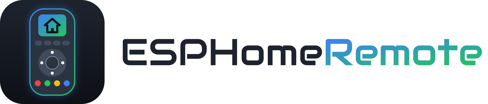
  </picture>
</p>

<h3 align="center">Die Fernbedienung, die dein Smart Home verdient.</h3>

<p align="center">
  Touch-Display · Bluetooth · Infrarot · Sprache · eine Dockingstation, die alles verbindet.<br>
  Komplett im Browser eingerichtet, direkt in Home Assistant – <b>ohne Programmieren, ohne YAML-Gefummel</b>.
</p>

<p align="center">
  <a href="https://github.com/Aggro600/ESPHomeRemote/releases"></a>
  <a href="https://my.home-assistant.io/redirect/hacs_repository/?owner=Aggro600&repository=ESPHomeRemote&category=integration"></a>
  
  
  <a href="https://github.com/Aggro600/ESPHomeRemote/blob/master/LICENSE"></a>
</p>

<p align="center">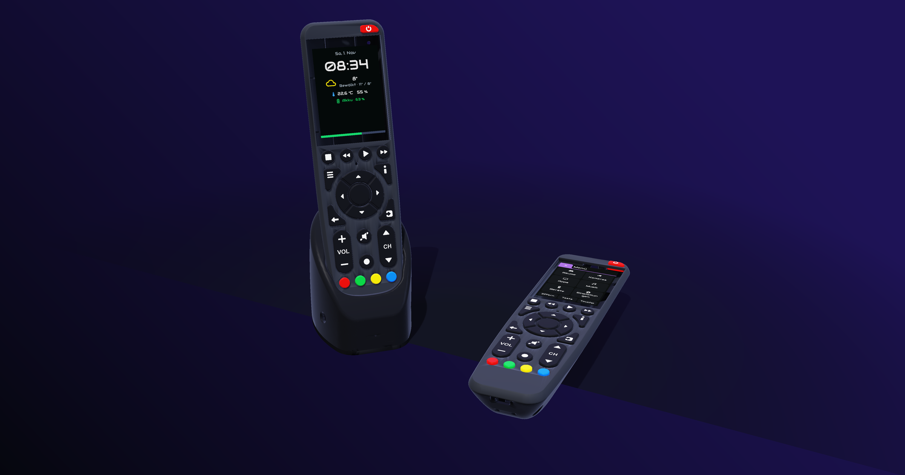<br>
<sub>Gerendert aus dem 3D-Modell der Hardware (<a href="https://github.com/LORDSn1per/OpenRemote-Hardware">OpenRemote Rev6</a>, GPL-3.0) – auf den Displays läuft diese Firmware.</sub></p>

<p align="center">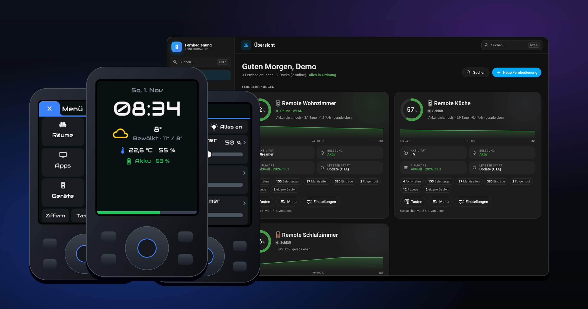</p>

<p align="center">
  <a href="#schnellstart"><b>▶ In 30 Minuten startklar</b></a> &nbsp;·&nbsp;
  <a href="https://aggro600.github.io/ESPHomeRemote/showcase/"><b>🧊 In 3D ansehen</b></a> &nbsp;·&nbsp;
  <a href="https://github.com/Aggro600/ESPHomeRemote/blob/master/CHANGELOG.md"><b>✨ Was ist neu</b></a>
</p>

---

<table>
<tr>
<td width="33%" valign="top">

### 🖱️ Ohne eine Zeile Code
Tasten, Menüs, Startseiten, Popups und Widgets – alles in einem durchdachten Konfigurator in der Seitenleiste
von Home Assistant, am PC und am Handy. Änderungen sind in Sekunden auf der Remote.

</td>
<td width="33%" valign="top">

### ⚡ Sofort da, selbst aus dem Schlaf
Die Dockingstation leitet Tasten, Befehle und den Stand per Funk weiter. Remote mit einer Taste wecken – die
Taste ist schon unterwegs, bevor das Display an ist.

</td>
<td width="33%" valign="top">

### 🔋 Wochen mit einer Ladung
Tiefschlaf mit klugem Wecken: hochheben, antippen oder irgendeine Taste. WLAN nur, wenn es wirklich nötig ist –
den Rest macht das Dock.

</td>
</tr>
</table>

---

## Eine Fernbedienung für alles

<p align="center">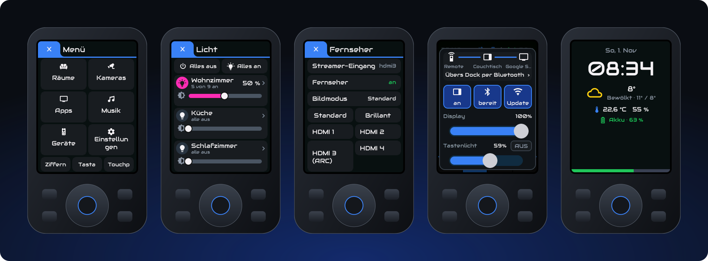</p>

- **Fernseher, Streamer, Tablets und PCs per Bluetooth** – vier Geräte, umgeschaltet über *Aktivitäten* wie bei
  einer Harmony, als Tasten, **Maus (Touchpad)** oder **Tastatur**.
- **Infrarot für den Rest** – rund 270.000 Geräte aus der Flipper-IRDB und dem Logitech-Harmony-Archiv, dazu
  eigene, angelernte Codes.
- **Dein Smart Home auf dem Display** – Licht mit Reglern und Farben, Rollos, Sensoren, Kameras, Szenen,
  Klingel-Popups.
- **Sprachassistent** – Google am Fernseher oder Home Assistant Assist, mit eingebautem Mikrofon.
- **Bewegungsgesten** – schütteln, kippen oder eigene anlernen (Kreis, Wischen …).

## Alles im Browser einstellen

<p align="center"></p>

Die Seite **Fernbedienung** in der Seitenleiste von Home Assistant zeigt jede Remote und jedes Dock auf einen
Blick – Akku mit 24-Stunden-Verlauf, Verbindung, Firmware und Hinweise mit einem Knopf zum Beheben.

<table>
<tr>
<td width="50%">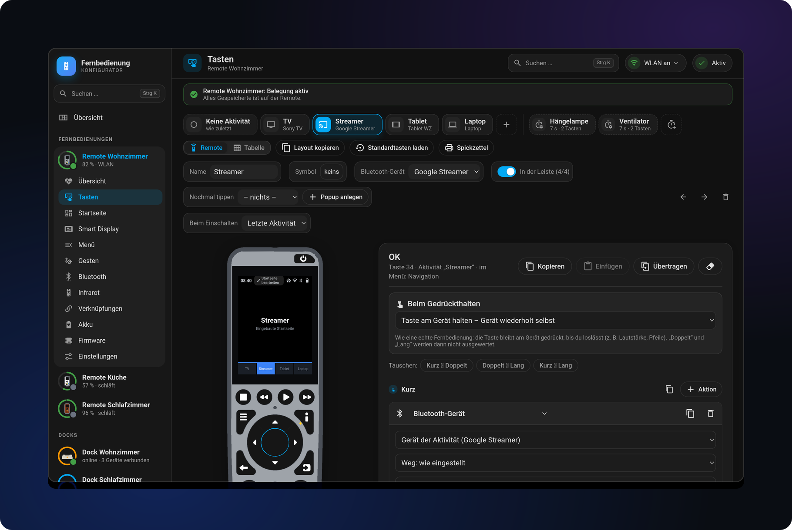</td>
<td width="50%">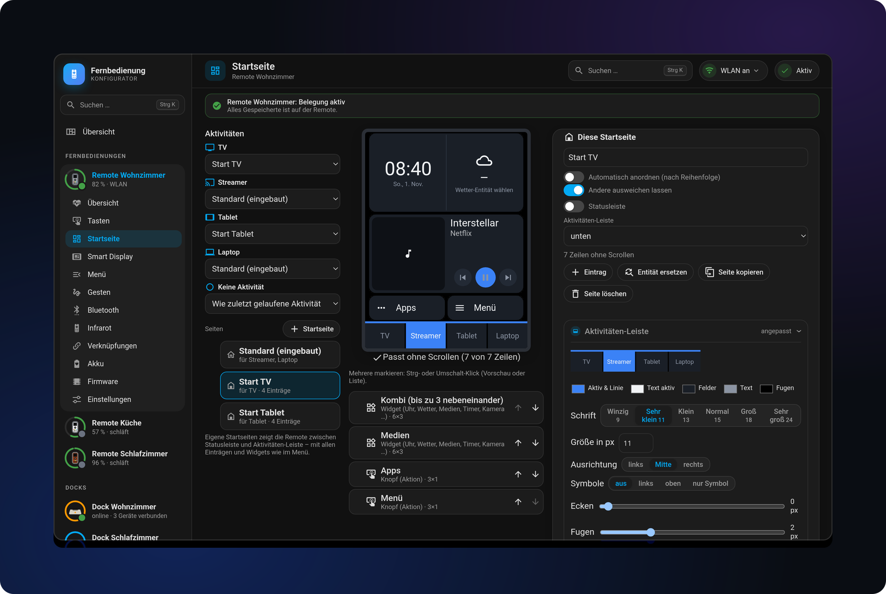</td>
</tr>
<tr>
<td valign="top"><b>Jede Taste, wie du willst</b> – Taste auf der virtuellen Remote antippen, Aktionen für kurz,
doppelt und lang anlegen: Bluetooth, Home Assistant, Infrarot, 433 MHz oder Funktionen der Remote. Je Aktivität
anders.</td>
<td valign="top"><b>Startseiten je Aktivität</b> – Uhr, Wetter, Medien, Timer, Kamera und Licht als Widgets im
Raster, mit einer Live-Vorschau, die genau wie das Display aussieht.</td>
</tr>
</table>

## Ein Smart Display im Dock

<p align="center">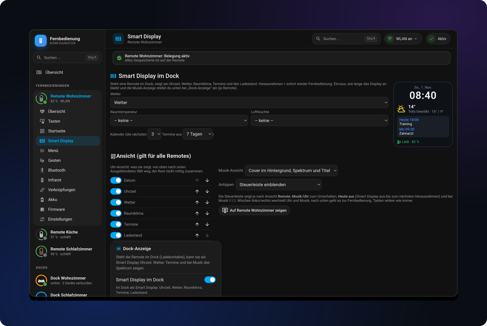</p>

Stell die Remote ins Dock, und sie wird zum Display für Nachttisch oder Couchtisch: **Uhrzeit, Wetter,
Raumklima, Termine und Ladestand** – welche Teile und in welcher Reihenfolge, bestimmst du. Läuft Musik,
wechselt sie zum **Spektrum-Analyser**, auf Wunsch über dem Cover. Antippen zeigt eine **Steuerleiste**: zurück
zur Fernbedienung, Musik ⇄ Uhr, ⏮ ⏯ ⏭ – oder *Heute aus* (aus, bis du sie aus dem Dock nimmst).

## Apps öffnen – ganz einfach

<p align="center">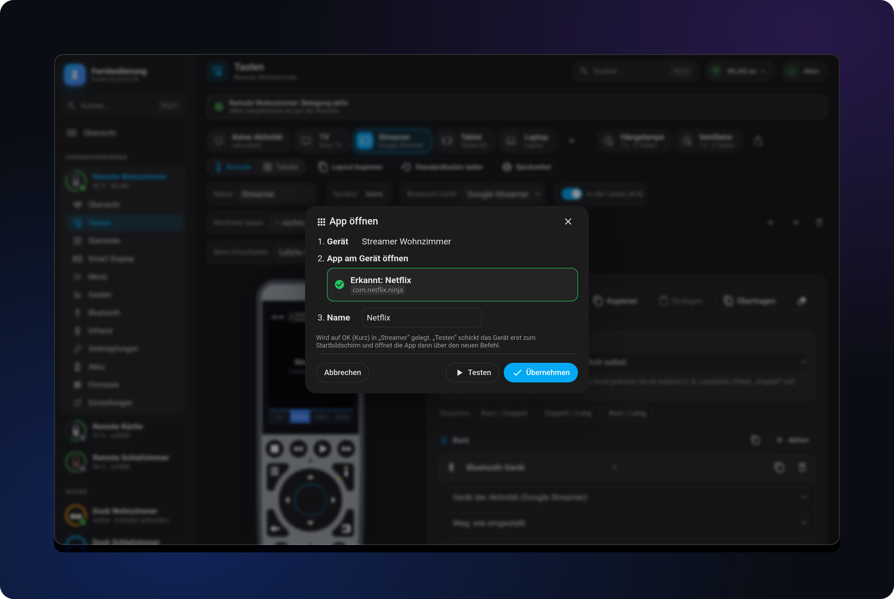</p>

Eine Taste, die Netflix öffnet? Öffne die App einmal am Fernseher – der Assistent **erkennt sie**, schlägt den
Namen vor und legt den Befehl an. Mit einem Klick testen. Genau dort, wo du ihn brauchst: im Tasten-Editor und
in jedem Menü oder Popup.

## Immer im Blick, wie gefunkt wird

<table>
<tr>
<td width="34%" align="center">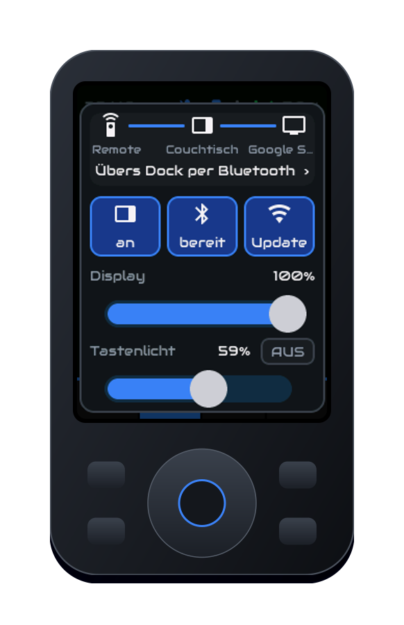</td>
<td width="66%">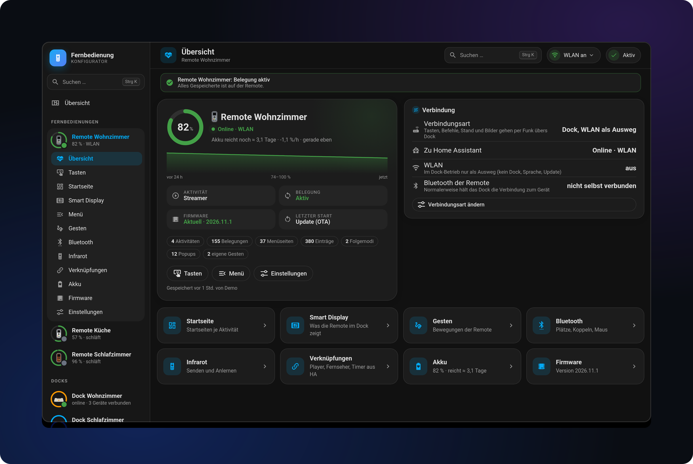</td>
</tr>
<tr>
<td valign="top"><b>Schnelleinstellungen</b> zeigen den Funkweg live: Remote → Dock → Gerät, jede Strecke blau,
wenn sie steht, rot, wenn nicht. Getrennte Schalter für Dock-Betrieb, Bluetooth und WLAN.</td>
<td valign="top"><b>Übersicht je Remote</b> – Verbindung, Akku, Firmware und Abkürzungen zu allen Seiten.</td>
</tr>
</table>

## Die Dockingstation

<table>
<tr>
<td width="50%">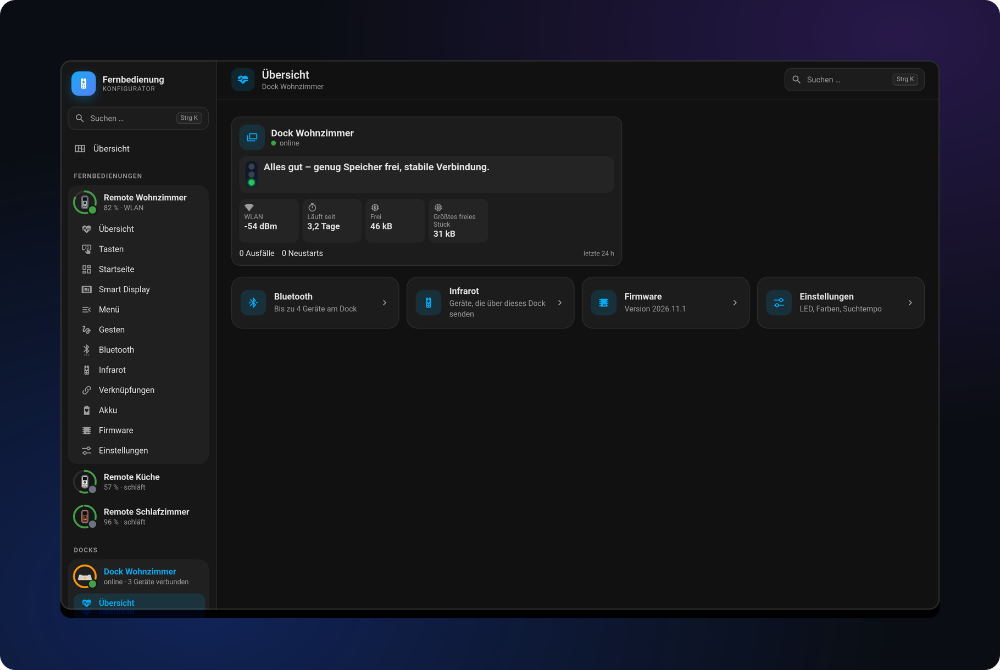</td>
<td width="50%">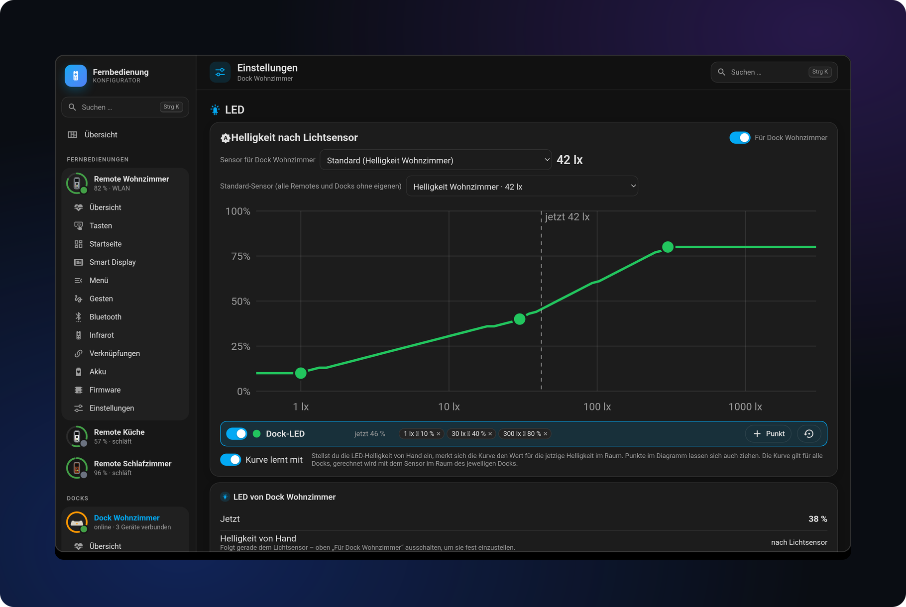</td>
</tr>
<tr>
<td valign="top"><b>Die Zentrale</b> (ESP32-C3) – hält bis zu vier Bluetooth-Geräte verbunden, ist
<b>IR-Blaster</b> und <b>433-MHz-Sender</b> für Home Assistant und funkt alles für die Remote weiter.</td>
<td valign="top"><b>Licht, das dem Raum folgt</b> – Display, Tastenbeleuchtung und Dock-LED richten sich nach
einem Lichtsensor. Kurve ziehen; sie lernt mit, wenn du nachregelst.</td>
</tr>
</table>

## Noch mehr Highlights

<table>
<tr>
<td width="50%">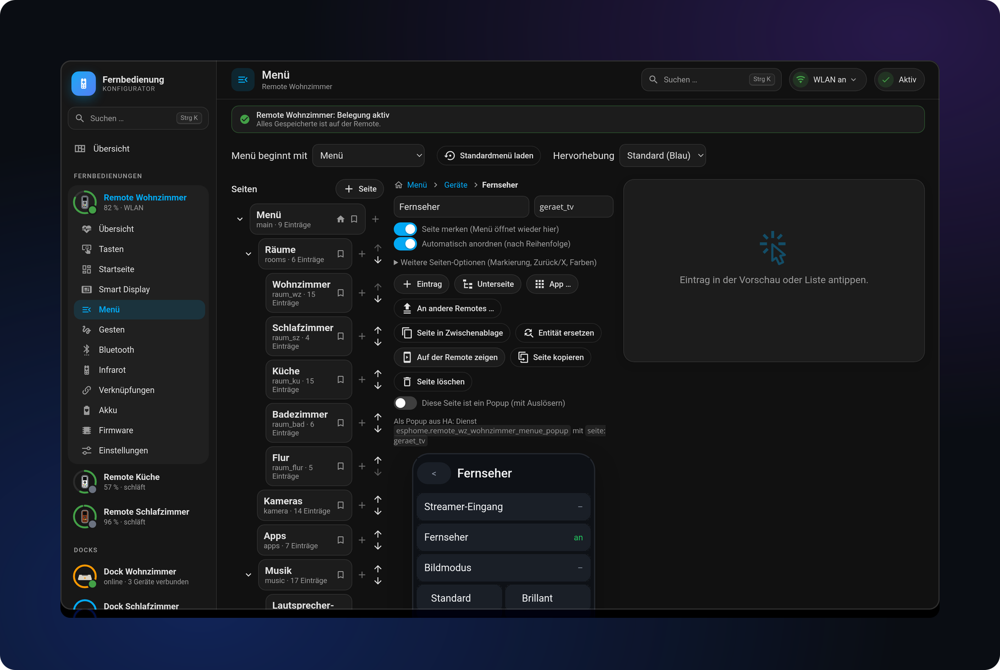</td>
<td width="50%">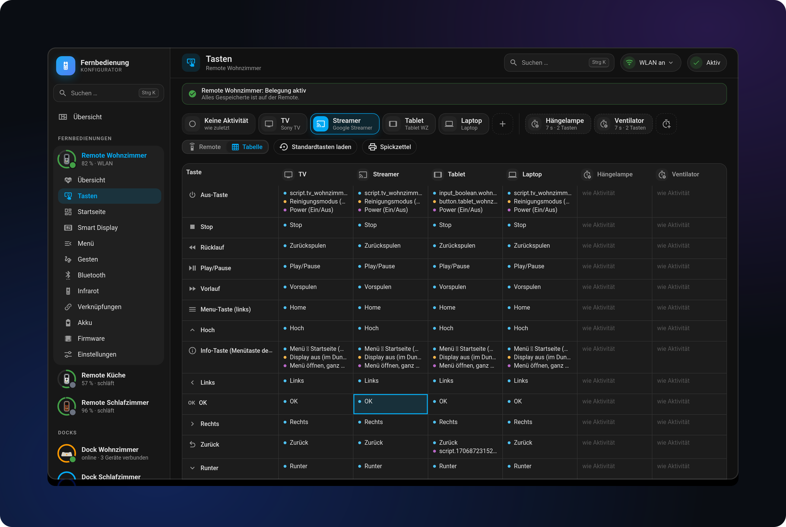</td>
</tr>
<tr>
<td valign="top"><b>Menü-Editor</b> – Seiten, Unterseiten und Popups, die von selbst aufgehen (Klingel,
Sleeptimer, Bildmodus …). Eine Seite mit einem Klick an deine anderen Remotes schicken.</td>
<td valign="top"><b>Tabelle</b> – alle Aktivitäten und Folgemodi nebeneinander.</td>
</tr>
<tr>
<td>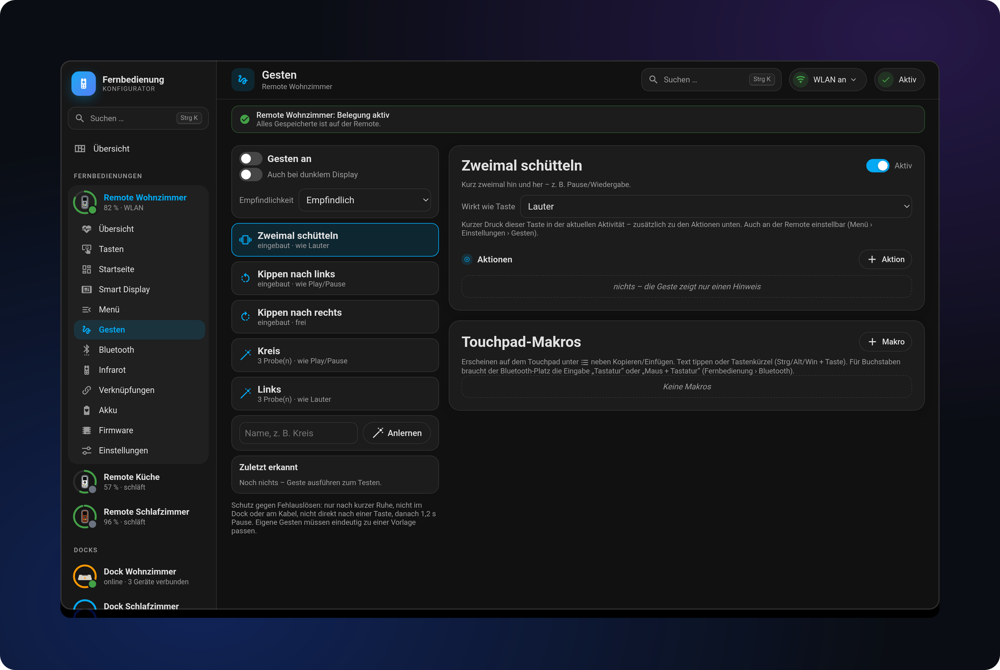</td>
<td>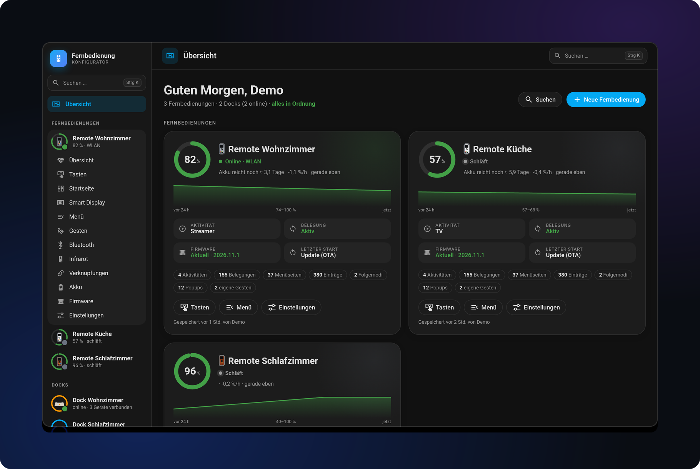</td>
</tr>
<tr>
<td valign="top"><b>Gesten</b> – eingebaute und eigene, erkannt egal wie du die Remote hältst.</td>
<td valign="top"><b>Suche (Strg K)</b> – findet jede Taste, Einstellung und Menüseite.</td>
</tr>
<tr>
<td align="center">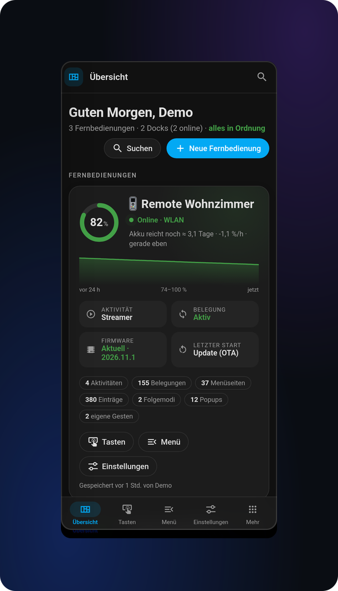 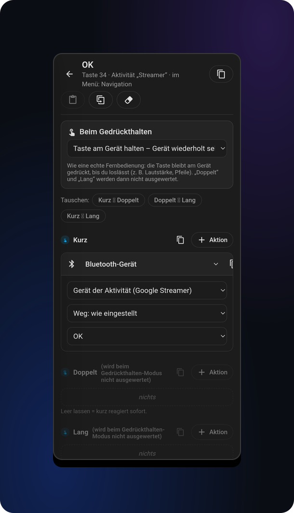</td>
<td>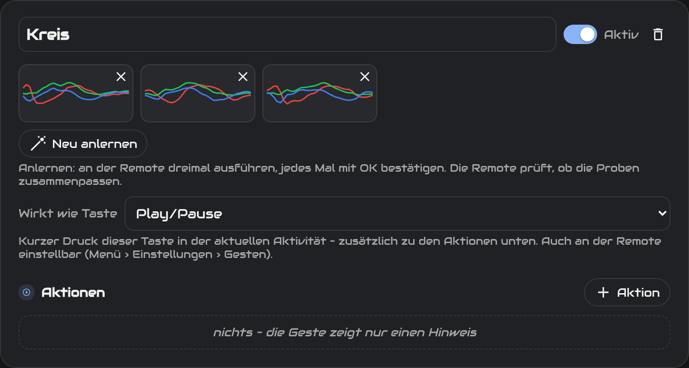</td>
</tr>
<tr>
<td valign="top"><b>Am Handy</b> – der ganze Konfigurator, gemacht für kleine Bildschirme.</td>
<td valign="top"><b>Geste anlernen</b> – dreimal ausführen, fertig.</td>
</tr>
</table>

<details>
<summary><b>Alle Funktionen im Detail</b></summary>

**Fernbedienung**
- **Steuert Fernseher, Streamer, Tablets und PCs per Bluetooth** – 4 Geräte, Umschalten über „Aktivitäten“
  wie bei Harmony. Je Gerät wählbar: nur Tasten, **Maus (Touchpad)**, **Tastatur** oder beides.
- **Jede Taste frei belegbar** – kurz, doppelt und lang getrennt, je Aktivität anders, mit Halten und Wiederholen.
  Dazu Schritte **beim Starten/Beenden** einer Aktivität (TV an, Eingang wählen …).
- **Folgemodi** – nach einer Aktion gelten ein paar Sekunden andere Tasten (z. B. Kanal +/− dimmt die Lampe).
- **Bewegungsgesten** – zweimal schütteln, kippen, und **eigene Gesten anlernen** (Kreis, Wischen …):
  erkannt wird die Form, egal wie groß, schnell oder wie man die Remote hält.
- **Touchpad** – das Display wird zur Maus, mit Scrollstreifen, Klicktasten und Tastenkürzel-Makros.
- **Infrarot** – rund 270.000 Geräte aus der Flipper-IRDB und dem Logitech-Harmony-Archiv (bleiben per GitHub aktuell),
  eigene Codes **anlernen** und verwalten; senden über die Remote, das Dock oder andere IR-Sender in Home Assistant (Broadlink …).
- **Sprachassistent** – Google auf dem Fernseher oder Home Assistant Assist.

**Display & Smart Home**
- **Eigenes Menü** – Seiten, Kacheln, Licht-Regler, Rollos, Anzeigen, Kamerabilder im Raster frei anordnen,
  dazu **Popups**, die von selbst aufgehen („Es hat geklingelt“, Sleeptimer, Bildmodus bei Netflix …).
- **Smart Display im Dock** – steht die Remote im Dock, zeigt sie Uhrzeit, Wetter, Raumklima, Termine und Ladestand.
- **Helligkeit nach Lichtsensor** – Display, Tastenlicht und Dock-LED folgen dem Raumlicht; die Kurve lernt mit.
- **Kamera und Klingel** – Bild auf der Fernbedienung, Kamera auf dem Fernseher (in drei Größen).
- **Lange Akkulaufzeit** – Tiefschlaf, wacht auf beim Hochheben, Klopfen oder Tastendruck; die Weck-Taste und alles,
  was während des Starts gedrückt wird, kommt trotzdem an.

**Dockingstation (optional, ESP32-C3)**
- **IR-Sender für Home Assistant** – jedes IR-Gerät wird ein Media-Player, eine Remote-Entität
  (`remote.send_command` mit Harmony-Befehlsnamen) und je Befehl ein Button. Dazu **433 MHz** (CC1101).
- **Aktivitäts-Schalter** – je Remote und Aktivität ein Schalter in Home Assistant.
- **Funkbrücke zu Home Assistant** – Tastenbefehle, Stand (Player, Fernseher, Timer) und Cover gehen per ESP-NOW
  verschlüsselt übers Dock: sofort nach dem Aufwachen, ohne dass die Remote erst eine Verbindung aufbaut.
  Im Konfigurator wählbar: **WLAN**, **Bluetooth**, **Dock + Bluetooth** oder **Dock, sparsam**.
- **Kein Dock? Jeder ESP32 geht** – ein ESP32, ESP32-S3, ESP32-C6 oder ein nackter ESP32-C3 ersetzt das Dock:
  Bluetooth-Proxy für die Remote, Bluetooth-Tastatur zum Fernseher und Funkbrücke laufen, IR, 433 MHz, LEDs und
  Ladekontakte fehlen. Geflasht wird aus dem Konfigurator per USB – der Chip wird automatisch erkannt.

**Konfigurator in Home Assistant** – alles im Browser, am PC und am Handy:
Übersicht mit Akkuverlauf, **Suche mit Strg+K**, Tabelle aller Tasten, Änderungsliste mit Rückgängig,
Sicherung, **Firmware-Updates per WLAN** (auch vormerken, wenn die Remote schläft) und **USB-Flashen im Browser**.
Einstellungen gleichen sich in beide Richtungen ab: was du an der Remote umstellst, sieht der Konfigurator.

</details>

---

## Was du brauchst

- Die Fernbedienung: **OMOTE / Open Remote, Platine Rev6** (ESP32-S3).
  Hardware: https://github.com/OMOTE-Community/OMOTE-Hardware
  Du bekommst die PCBs evtl. über den Discord buy/sell: https://discord.com/invite/5PnYFAsKsG
  
- Ein **USB-C-Kabel** und einen PC mit **Chrome oder Edge** (zum ersten Aufspielen).
- Für alle Funktionen: **Home Assistant** mit dem **ESPHome**-Add-on (oder „ESPHome Device Builder“)
  und **HACS** (für den Konfigurator).

---

## Schnellstart

> **Web-Installer (ohne Home Assistant):** kommt zurück, sobald es fertig gebaute Firmware zum Herunterladen gibt.
> Bis dahin geht es über Home Assistant (unten).

### Mit Home Assistant (empfohlen)

**Schritt 1 – ESPHome bereitlegen**
In Home Assistant: *Einstellungen → Add-ons → Add-on-Store →* **ESPHome Device Builder** installieren
und starten.

**Schritt 2 – Konfigurator installieren (über HACS)**
1. Falls noch nicht da: **HACS** installieren (https://hacs.xyz – einmalig, 5 Minuten).
2. In Home Assistant **HACS** öffnen, nach **„ESPHomeRemote“** suchen → **Herunterladen**
   (oder [In HACS öffnen](https://my.home-assistant.io/redirect/hacs_repository/?owner=Aggro600&repository=ESPHomeRemote&category=integration) anklicken).
   *Nicht gefunden?* Ältere HACS-Version oder veraltete Liste: oben rechts **⋮** → **„Benutzerdefinierte Repositories“** →
   `https://github.com/Aggro600/ESPHomeRemote` einfügen, Typ **„Integration“** → **Hinzufügen**, dann noch einmal suchen.
3. Home Assistant **neu starten** (*Einstellungen → System → oben rechts ⏻ → Neu starten*).
4. *Einstellungen → Geräte & Dienste →* **„+ Integration hinzufügen“** → **„ESPHomeRemote“**.
   Den Namen der Fernbedienung so lassen (`esphomeremote`) → **Absenden**.
5. Es erscheint eine Zeile wie `esphomeremote_key: "…"` – **kopieren**, die brauchst du gleich.

**Schritt 3 – Passwörter eintragen**
Im ESPHome-Add-on oben rechts auf **„Secrets“** klicken und diese Zeilen ergänzen
(WLAN steht meist schon drin, die Passwörter sind frei wählbar):
```yaml
ota_pw: "ein-passwort"
ap_password: "noch-ein-passwort"
direkt_schluessel: "…"             # 32 Hex-Zeichen, z. B. von  openssl rand -hex 16  (Funkweg zum Dock)
esphomeremote_key: "…"      # die kopierte Zeile aus Schritt 2
```

*Eigener fester API-Schlüssel statt OTA-Passwort:* Die Firmware schützt Updates mit `ota_pw`, weil Home Assistant den
API-Schlüssel erst beim Einbinden vergibt. Setzt du selbst einen festen Schlüssel, warnt ESPHome, das Passwort
„verschwende Flash und RAM“. Dann das hier in die YAML deines Geräts, und `ota_pw` brauchst du nicht mehr:
```yaml
api:
  encryption:
    key: !secret api_key
ota:
  - id: !extend ota_esphome
    password: !remove
    encryption: {}
```

**Schritt 4 – Fernbedienung aufspielen**
1. Im ESPHome-Add-on **„+ Neues Gerät“** → **„Überspringen“** (bzw. „Leer anlegen“).
2. Den Inhalt von [`esphomeremote.yaml`](https://github.com/Aggro600/ESPHomeRemote/blob/master/esphomeremote.yaml) in den Editor kopieren – anpassen musst du nichts
   (die Adresse von Home Assistant findet die Fernbedienung selbst).
3. **Speichern** → **Installieren** → *„An diesen Computer anschließen“* → Fernbedienung per USB-C
   anstecken und auswählen. Das erste Mal dauert es etwa 10 Minuten.

**Schritt 5 – In Home Assistant übernehmen**
1. Home Assistant meldet *„Neues Gerät gefunden“* (*Einstellungen → Geräte & Dienste*) → **Hinzufügen**.
2. Beim Gerät auf **„Konfigurieren“** → **„Gerät darf Home-Assistant-Aktionen ausführen“** einschalten.
3. Fertig! Links in der Seitenleiste ist jetzt **„Fernbedienung“** – dort stellst du alles ein.

---

### Streamer-App (optional)

Für Titel, Cover und das Tastatur-Popup von einem Android-TV-Streamer: am Streamer die Entwickleroptionen und
USB-Debugging einschalten, in Home Assistant die Integration **Android Debug Bridge** mit seiner IP hinzufügen, dann
im Konfigurator *Wiedergabe → Streamer anlegen* → **Einrichten**. Die App kommt mit der Integration mit; Updates und
Deinstallieren gehen dort genauso. Auf dem Fernseher zeigt sie unter „ESPHomeRemote Streamer“, ob alles läuft.

### Updates

- **Konfigurator:** Home Assistant meldet neue Versionen wie bei jeder HACS-Integration (*Einstellungen → Updates*),
  mit der Liste, was neu ist. Installieren, Home Assistant neu starten – fertig.
- **Fernbedienungen und Docks:** danach im Konfigurator unter *Firmware* steht „Neue Version …“ –
  **Alle aktualisieren** baut und spielt sie auf (schlafende Remotes kurz anfassen).
- Die Firmware kommt vom Zweig `stabil` (letzter Release).
- Was neu ist: [CHANGELOG.md](https://github.com/Aggro600/ESPHomeRemote/blob/master/CHANGELOG.md).


## Der Konfigurator

In der Seitenleiste **„Fernbedienung“** – am Handy und am PC. Links stehen deine Remotes und Docks; aufklappen
zeigt ihre Seiten:

**Je Remote**

| Seite | Was du dort machst |
|---|---|
| **Übersicht** | Zustand, Verbindung (Dock, WLAN, Bluetooth), Firmware und Abkürzungen zu allen Seiten. |
| **Tasten** | Jede Taste je Aktivität: kurz / doppelt / lang. Bluetooth, Home Assistant, Infrarot, 433 MHz, Funktionen der Remote, der **App-Assistent**. Aktivitäten, Folgemodi, Tabelle, Popup beim erneuten Antippen der laufenden Aktivität. |
| **Startseite** | Eine Startseite je Aktivität mit Einträgen und Widgets – oder die eingebaute anpassen. Was das Antippen des Covers öffnet. An andere Remotes übertragen. |
| **Smart Display** | Was die Remote im Dock zeigt: Teile und Reihenfolge, Musik-Ansicht (Spektrum, Titel, Cover), Steuerleiste, Zeiten. |
| **Menü** | Seiten, Unterseiten und Popups (Klingel, Timer, Bildmodus …) im Raster mit Vorschau. Seiten an andere Remotes übertragen. |
| **Gesten** | Schütteln, Kippen und eigene Gesten; Touchpad-Makros. |
| **Bluetooth / Infrarot** | Plätze koppeln, Eingabeart je Gerät, IR-Weg (Remote, Dock, andere IR-Sender). |
| **Verknüpfungen** | Welche Geräte aus Home Assistant die Remote nutzt: „Jetzt läuft“-Player, Fernseher, Multiroom, Lautsprecher für den Assistenten, Streamer, Timer. |
| **Akku** | Verlauf, Verbrauch je Zustand, Ladungen, warum sie nicht geschlafen hat. |
| **Firmware** | Version, Update per WLAN oder USB. |
| **Einstellungen** | Alle Einstellungen der Remote, sofort wirksam; Übersicht „Welcher Funk wofür?“. |

**Je Dock:** Übersicht · Bluetooth (Geräte am Dock) · Infrarot (IR-Geräte) · Firmware · Einstellungen (LED,
Farben, Suchtempo).

**Für das ganze Zuhause:** **IR-Codes** (IR-Datenbanken und eigene Codes) · **Abgleich** (Remotes synchron
halten, zwei Remotes vergleichen) · **Prüfen & Finden** (alles prüfen, finden wo eine Entität benutzt wird) ·
**Werkstatt** (Updates für alle Geräte, neue Remote oder neues Dock, Sicherung, Platinentest).

**Speichern** (oder Strg+S) schickt alles an die Remote – schläft sie, holt sie es beim nächsten Aufwachen.

---

## Bedienung in Kürze

- **Menü-Taste**: Menü öffnen / schließen. Doppelt: Display aus.
- **Steuerkreuz + OK**: im Menü bewegen, auf der Startseite steuert es das aktive Gerät.
- **Zurück**: eine Seite zurück, in Popups schließen.
- **Leiste unten auf der Startseite**: zwischen Fernseher, Streamer usw. umschalten.
- **Bluetooth koppeln**: Menü → Einstellungen → Bluetooth → Platz wählen → „Neu koppeln“,
  dann am Fernseher / Streamer nach „ESPHomeRemote“ suchen.

---

## Häufige Fragen

**Die Fernbedienung schaltet in Home Assistant nichts.**
Beim ESPHome-Gerät „Gerät darf Home-Assistant-Aktionen ausführen“ einschalten (Schritt 5).

**Im Konfigurator steht „noch nicht übertragen“.**
Die Fernbedienung schläft. Einmal eine Taste drücken – sie holt die Belegung dann ab.
Klappt es nie: Stimmt `esphomeremote_key` in den ESPHome-Secrets mit dem Schlüssel der
Integration überein (*ESPHomeRemote → Konfigurieren* zeigt ihn) und `ha_host` in der YAML?

**Mehrere Fernbedienungen?**
Für jede in ESPHome ein eigenes Gerät mit eigenem `device_name`/`ha_name` anlegen (Schritt 4).
Dann bei der Integration *ESPHomeRemote* auf **„Konfigurieren“** und den neuen Namen mit Komma ergänzen.

**Seiten zeigen „nicht verfügbar“.**
Einige eingebaute Seiten (Startseite-Player, Klingel, Sleeptimer) nutzen die Entitäten aus
`esphomeremote.yaml` → `substitutions`. Trage dort deine ein oder lass sie weg – das Menü baust du
ohnehin im Konfigurator.

**Kamera auf dem Fernseher in Klein / Mittel / Groß** (optional):
im Konfigurator unter **Funktionen → Kamera auf dem Fernseher** (App *HA TV Dashboard* auf dem Fernseher).
Dort stellst du auch den TV-Eingang (für Popups wie „Nur wenn TV-Eingang ist nicht HDMI 3“) und den Neustart per ADB ein.

---

## Für Entwickler

- `esphomeremote-firmware.yaml` wird aus der Entwickler-Fassung erzeugt (`tools/publish.py`
  im Entwickler-Setup) – Änderungen bitte dort, nicht hier.
- Eigene Komponenten in `components/`: Display (`ili9341_i80`), Tastenfeld (`tca8418`), Akku
  (`max17048`), Lagesensor (`lis3dh`), Bluetooth-HID (`espidf_ble_keyboard`, `atv_voice`),
  Konfigurator (`tasten_konfig`, `menue`), SD-Karte, Touch (`ft63x6`).
- `custom_components/esphomeremote`: Integration mit Panel
  (`frontend/configurator.js`), liefert die Belegung per HTTP an die Fernbedienung.

**Entwickler-Fassung (1:1 wie im Einsatz)** – zusätzlich zur einfachen Fassung oben liegt hier alles, womit die
Remotes tatsächlich gebaut werden:
- `templates/remote.yaml` (Firmware) und `templates/remote-halink.yaml` (Bluetooth-Schicht „Nur Bluetooth“,
  HA über BLE/Dock – diese Datei wird geflasht), `templates/dock-base.yaml` (Dockingstation = `dock-core.yaml` + `dock-board.yaml`; ein Dock-Nachbau auf einem anderen ESP32 nutzt nur den Kern),
  `remote-dev-tests.yaml` (Testwerkzeuge, abschaltbar).
- `tools/remotes.py` erzeugt daraus je Remote `remote-wz-<name>.yaml` und `remote-wz-<name>-halink.yaml`
  (Liste in `tools/remotes.json`, IP-Secret `ip_remote_wz_<name>`). Bauen/Flashen: `tools/esphome_run.mjs`.
  Für diese Remotes betreibt die Integration eine Bluetooth-Brücke unter `127.0.0.1:<Port>` (ab 16053). Die ESPHome-Einträge
  stellt sie nicht selbst um: zeigt einer woandershin, nennt ein Reparatur-Hinweis Host und Port; eintragen über
  ESPHome → Neu konfigurieren oder im Konfigurator (Firmware) mit „ESPHome-Einträge auf die Brücke stellen“ (fragt vorher).
- `components/ha_tunnel`, `components/network` (Bluetooth-Schicht), `components/dock_direkt`, `dock_hid`,
  `bluetooth_connection` (Dock), `custom_components/esphomeremote/ble_link.py` (HA-Gegenstück der Bluetooth-Schicht),
  `home-assistant/packages/` (YAML-Alternative zur Integration), `docs/development/` (Architektur, Funkkonzept, Messungen).

## Lizenz

MIT, siehe [LICENSE](https://github.com/Aggro600/ESPHomeRemote/blob/master/LICENSE). Fremd-Assets: [THIRD-PARTY.md](https://github.com/Aggro600/ESPHomeRemote/blob/master/THIRD-PARTY.md).
