<p align="center"><b>🇬🇧 <a href="README.md">English</a></b> · 🇩🇪 <a href="README.de.md">Deutsch</a></p>

<p align="center">
  <picture>
    <source media="(prefers-color-scheme: dark)" srcset="docs/bilder/logo-dunkel.png">
    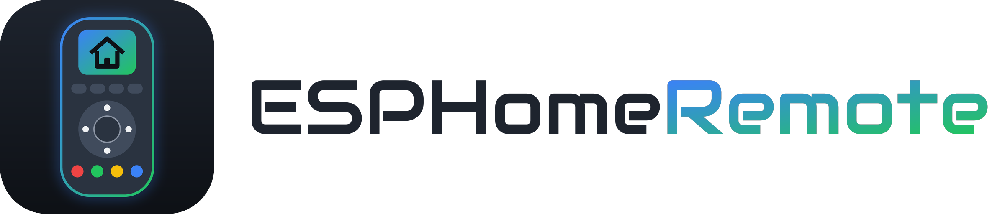
  </picture>
</p>

# ESPHomeRemote

**One remote for your TV, streamer and your whole smart home** – with touch display, Bluetooth and voice
assistant, built on the *OMOTE / Open Remote Rev6* board and written entirely in **ESPHome**. You set up keys,
menu and home screen comfortably in your browser inside **Home Assistant**, without programming.

> No programming skills needed. If you already use Home Assistant, you'll be done in about 30 minutes.
>
> **Language:** The configurator in Home Assistant and the texts on the remote's display are currently in
> **German**. The names in this guide are given in German as they appear on screen, with the English meaning
> next to them.

<p align="center"><a href="https://aggro600.github.io/ESPHomeRemote/showcase/">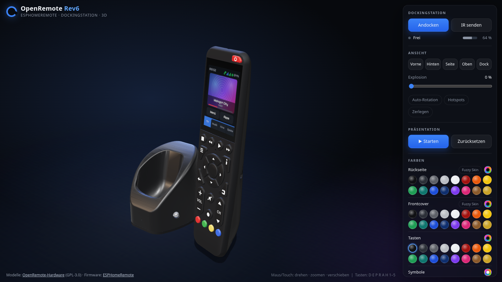</a></p>
<p align="center"><b><a href="https://aggro600.github.io/ESPHomeRemote/showcase/">▶ See the remote and docking station in 3D</a></b><br>
<sub>Interactive in your browser: built from the original CAD data, with the real display UI, docking, charging and exploded view</sub></p>

---

## What it does

<p align="center">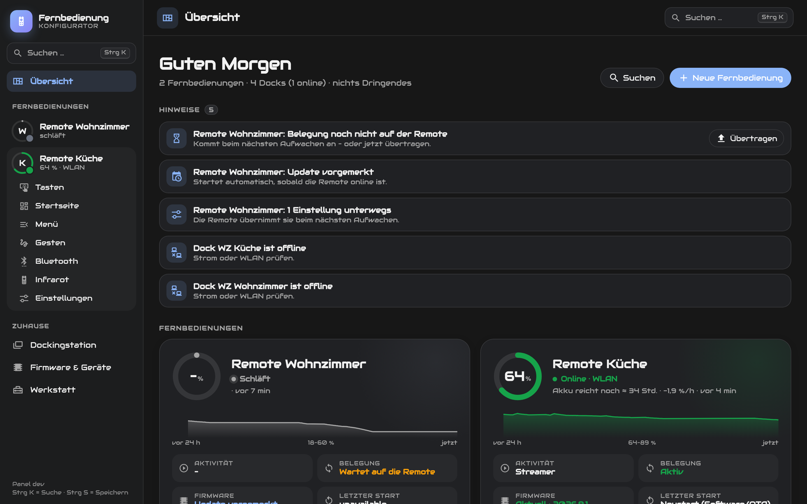</p>

**Remote control**
- **Controls TVs, streamers, tablets and PCs via Bluetooth** – 4 devices, switched by "activities" like a Harmony.
  Per device: keys only, **mouse (touchpad)**, **keyboard** or both.
- **Every key freely assignable** – short, double and long press separately, different per activity, with hold
  and repeat. Plus steps **when starting/ending** an activity (turn the TV on, pick the input …).
- **Follow-up modes** – after an action, other keys apply for a few seconds (e.g. channel +/− dims the lamp).
- **Motion gestures** – shake twice, tilt, and **teach your own gestures** (circle, swipe …): the shape is
  recognised no matter how large or fast, or how you hold the remote.
- **Touchpad** – the display becomes a mouse, with scroll strip, click buttons and shortcut macros.
- **Infrared** – about 270,000 devices from the Flipper IRDB and the Logitech Harmony archive (kept up to date from
  GitHub), **learn** and manage your own codes; send through the remote, the dock or other IR blasters in Home
  Assistant (Broadlink …).
- **Voice assistant** – Google on the TV or Home Assistant Assist.

**Display & smart home**
- **Your own menu** – pages, tiles, light sliders, covers, sensors and camera images, freely arranged on a grid,
  plus **popups** that open by themselves ("someone rang the doorbell", sleep timer, picture mode for Netflix …).
- **Home screen per activity** – with widgets: clock, weather with forecast, media player, timer, camera.
- **Smart display in the dock** – while docked, the remote shows time, weather, room climate, appointments and
  battery level.
- **Brightness from the light sensor** – display, key backlight and dock LED follow the room light; the curve
  learns as you adjust it.
- **Camera and doorbell** – image on the remote, camera on the TV (in three sizes).
- **Long battery life** – deep sleep, wakes up when lifted, tapped or a key is pressed; the wake-up key and
  everything pressed during start-up still arrives.

**Docking station (optional, ESP32-C3)**
- **IR blaster for Home Assistant** – every IR device becomes a media player, a remote entity
  (`remote.send_command` with Harmony command names) and a button per command. Plus **433 MHz** (CC1101).
- **Activity switches** – one switch per remote and activity in Home Assistant.
- **Radio bridge to Home Assistant** – key commands, state (player, TV, timer) and cover art go encrypted via
  ESP-NOW through the dock: right after waking up, without the remote having to connect first.
  Selectable in the configurator: **Wi-Fi**, **Bluetooth**, **Dock + Bluetooth** or **Dock, power saving**.

**Configurator in Home Assistant** – everything in the browser, on PC and phone:
overview with battery history, **search with Ctrl+K**, table of all keys, change list with undo, backup,
**firmware updates over Wi-Fi** (can be queued while the remote sleeps) and **USB flashing in the browser**.
Settings sync both ways: what you change on the remote shows up in the configurator.

---

## Pictures

| | |
|---|---|
| 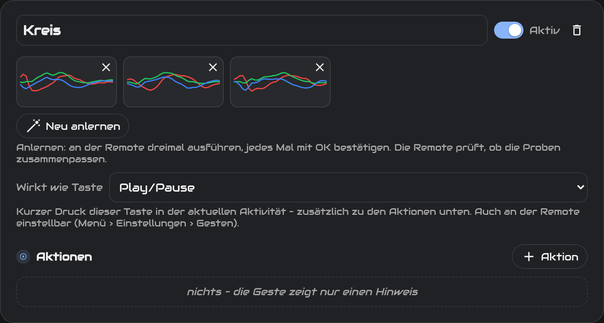 | 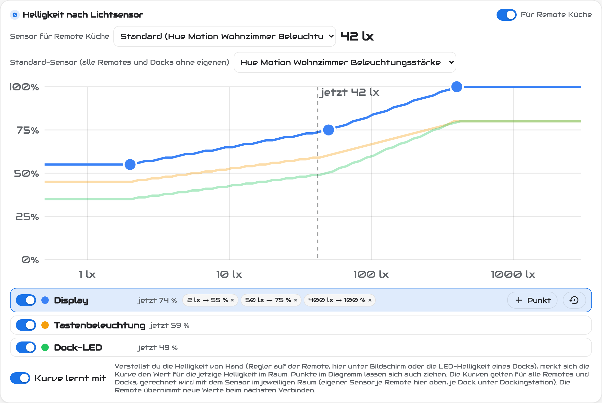 |
| **Custom gesture "circle"** – performed three times on the remote, the samples (X/Y/Z) in the configurator. | **Brightness from the light sensor** – drag the points; the curve learns while you adjust. |
| 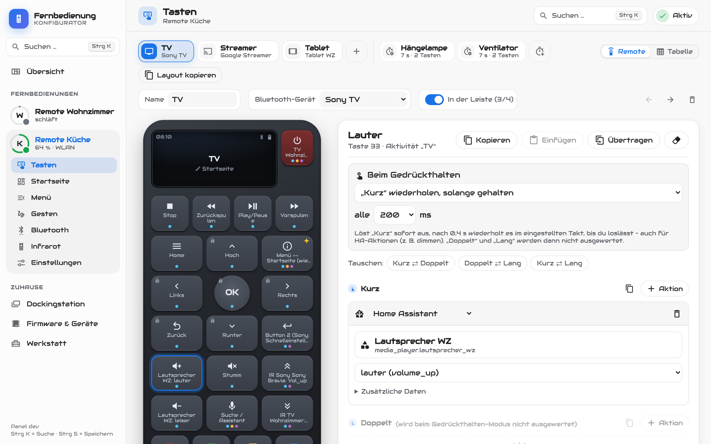 | 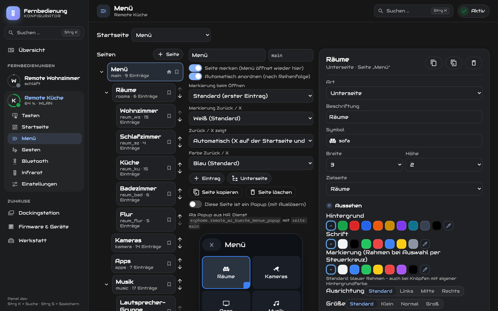 |
| **Keys** – tap the remote, add actions per press type. | **Menu editor** – with a live preview of the display. |
| 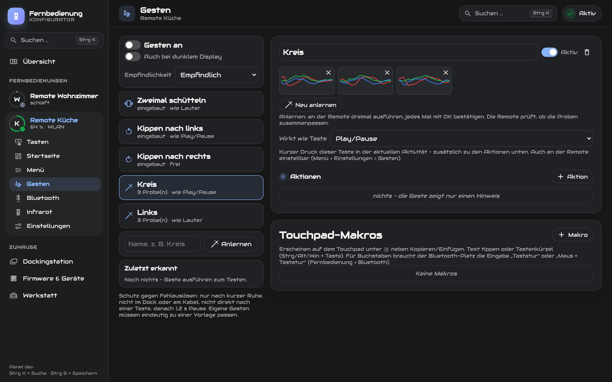 | 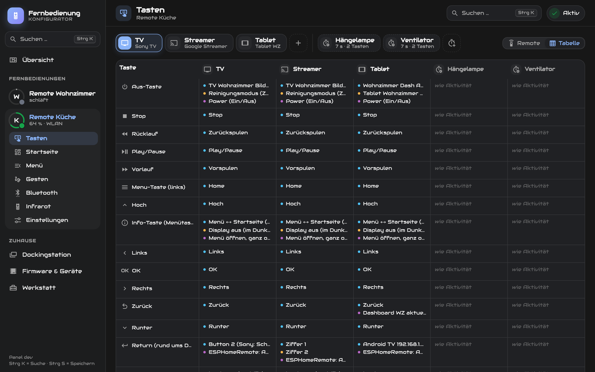 |
| **Gestures** – built-in and custom, "acts like key" or own actions. | **Table** – all activities and follow-up modes side by side. |
| 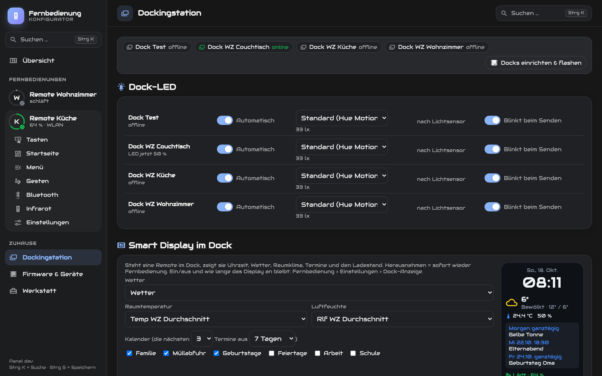 | 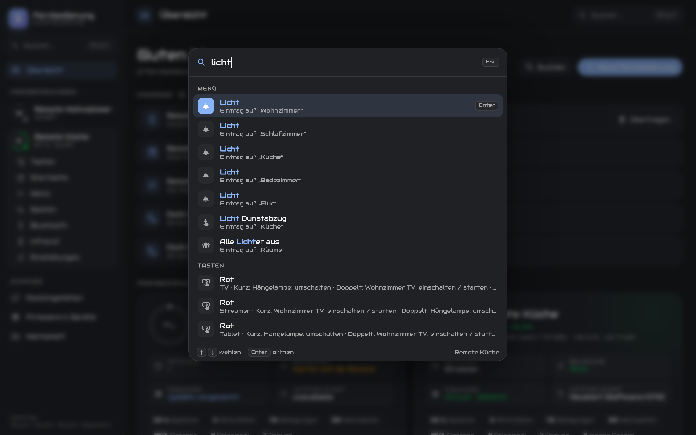 |
| **Docking station** – dock LED, smart display with preview, IR devices. | **Search (Ctrl+K)** – finds every key, setting and menu page. |
| 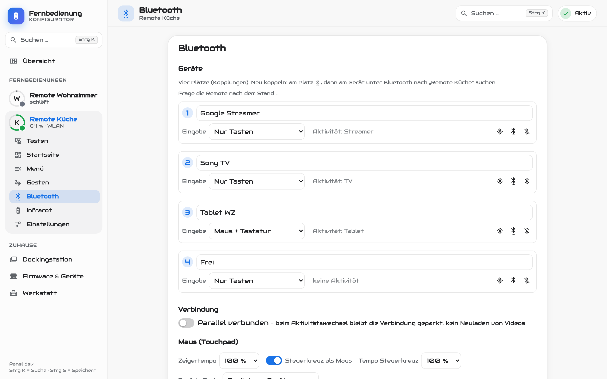 | 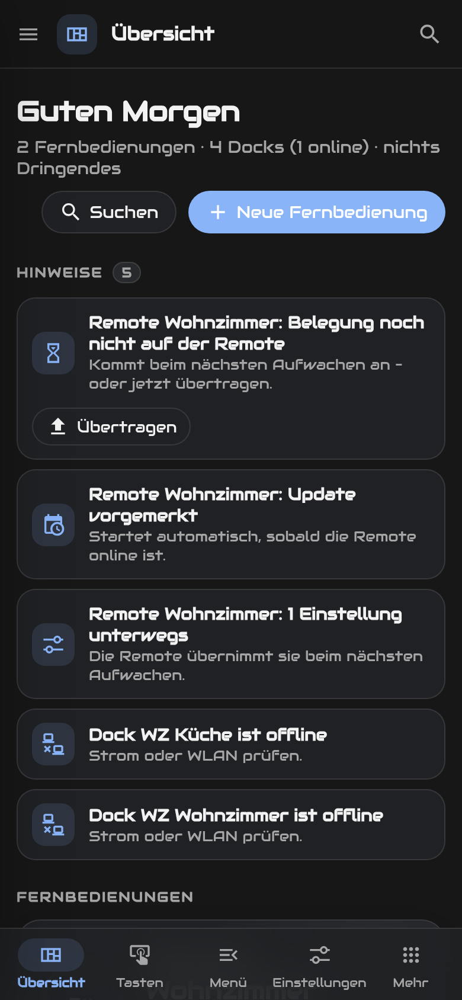 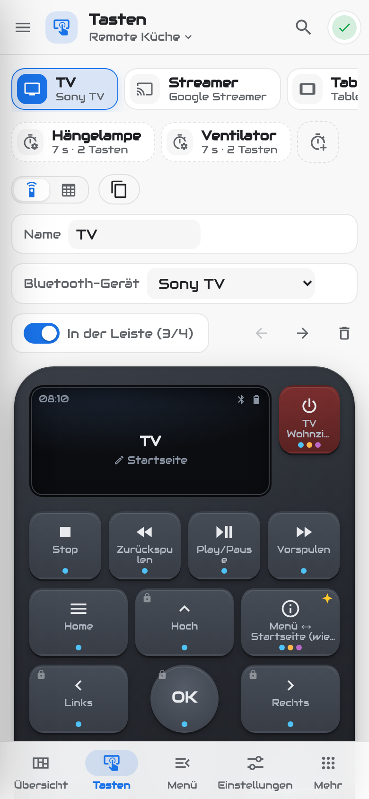 |
| **Bluetooth** – four slots, input mode per device, mouse settings. | **On the phone** – same features, bar at the bottom. |

---

## What you need

- The remote: **OMOTE / Open Remote, board Rev6** (ESP32-S3).
  Hardware: https://github.com/OMOTE-Community/OMOTE-Hardware
  You may get PCBs via the Discord buy/sell channel: https://discord.com/invite/5PnYFAsKsG
- A **USB-C cable** and a PC with **Chrome or Edge** (for the first flash).
- For all features: **Home Assistant** with the **ESPHome** add-on ("ESPHome Device Builder")
  and **HACS** (for the configurator).

---

## Quick start

> **Web installer (without Home Assistant):** will return as soon as there is ready-built firmware to download.
> Until then, use the Home Assistant route below.

### With Home Assistant (recommended)

**Step 1 – Get ESPHome ready**
In Home Assistant: *Settings → Add-ons → Add-on Store →* install and start **ESPHome Device Builder**.

**Step 2 – Install the configurator (via HACS)**
1. If you don't have it yet: install **HACS** (https://hacs.xyz – once, 5 minutes).
2. Open **HACS** in Home Assistant → **⋮** at the top right → **"Custom repositories"**.
3. Paste `https://github.com/Aggro600/ESPHomeRemote` – type **"Integration"** → **Add**.
4. Search HACS for **"ESPHomeRemote"** → **Download**.
5. **Restart** Home Assistant (*Settings → System → ⏻ at the top right → Restart*).
6. *Settings → Devices & services →* **"+ Add integration"** → **"ESPHomeRemote"**.
   Keep the remote's name as it is (`esphomeremote`) → **Submit**.
7. A line like `esphomeremote_konfig_key: "…"` appears – **copy** it, you'll need it in a moment.

**Step 3 – Enter passwords**
In the ESPHome add-on, click **"Secrets"** at the top right and add these lines
(Wi-Fi is usually already there; the passwords are up to you):
```yaml
ota_pw: "a-password"
ap_password: "another-password"
direkt_schluessel: "…"             # 32 hex characters, e.g. from  openssl rand -hex 16  (radio link to the dock)
esphomeremote_konfig_key: "…"      # the line you copied in step 2
```

**Step 4 – Flash the remote**
1. In the ESPHome add-on: **"+ New device"** → **"Skip"** (or "Create empty").
2. Copy the contents of [`esphomeremote.yaml`](esphomeremote.yaml) into the editor – no changes needed
   (the remote finds Home Assistant's address by itself).
3. **Save** → **Install** → *"Plug into this computer"* → connect the remote via USB-C and select it.
   The first build takes about 10 minutes.

**Step 5 – Adopt it in Home Assistant**
1. Home Assistant reports *"New device discovered"* (*Settings → Devices & services*) → **Add**.
2. On the device, click **"Configure"** → turn on **"Allow the device to perform Home Assistant actions"**.
3. Done! In the sidebar you now have **"Fernbedienung"** (remote) – that's where you set up everything.

---

### Streamer app (optional)

For title, cover art and the keyboard popup from an Android TV streamer: enable developer options and USB
debugging on the streamer, add the **Android Debug Bridge** integration with its IP in Home Assistant, then in
the configurator *Wiedergabe (playback) → Streamer anlegen (add streamer)* → **Einrichten (set up)**. The app ships
with the integration; updating and uninstalling work the same way. On the TV, "ESPHomeRemote Streamer" shows
whether everything is running. Details: [streamer-app/README.md](streamer-app/README.md).

### Updates

- **Configurator:** Home Assistant announces new versions like any HACS integration (*Settings → Updates*),
  with the list of what's new. Install, restart Home Assistant – done.
- **Remotes and docks:** afterwards the configurator shows "Neue Version …" (new version) under *Firmware* –
  **Alle aktualisieren** (update all) builds and flashes them (touch sleeping remotes briefly).
- The firmware comes from the `stabil` branch (latest release).
- **Old file names:** until 27 Oct 2026 the files were called `open-remote.yaml` / `open-remote-firmware.yaml` and
  `open-dock.yaml` / `open-dock-firmware.yaml`. The old firmware names still work for now; in the configurator
  under *Firmware*, **Umstellen** (switch over) changes the device file to the new names (the old one is kept as
  `.alt`). By hand: replace the `packages:` block with the one from [`esphomeremote.yaml`](esphomeremote.yaml).
- What's new: [CHANGELOG.md](CHANGELOG.md).


## The configurator

In the sidebar, **"Fernbedienung"** (remote) – on phone and PC. On the left are your remotes with battery level,
below each remote its pages:

| Page | What you do there |
|---|---|
| **Übersicht** (overview) | All remotes and docks: battery with 24 h history, connection, firmware, hints with buttons to fix them. |
| **Tasten** (keys) | Assign every key per activity: short / double / long. Bluetooth, Home Assistant action, infrared, 433 MHz, remote functions. Create activities and follow-up modes, table view. |
| **Startseite** (home screen) | A home screen per activity with entries and widgets (clock, weather, media, timer, camera) – or adjust the built-in one. |
| **Menü** (menu) | Design pages, sub-pages and popups on a grid, with preview. |
| **Gesten** (gestures) | Assign shake, tilt and custom gestures; touchpad macros. |
| **Bluetooth / Infrarot** (infrared) | Pair slots, input mode per device, IR route (remote, dock, other IR blasters). |
| **Verknüpfungen** (links) | Which Home Assistant devices the remote uses: playback player (home screen, media page, music display), TV, multiroom, speaker for the assistant, streamer for text input, timer next to the clock. |
| **Einstellungen** (settings) | All remote settings, applied immediately; brightness from the light sensor. |
| **Wiedergabe** (playback) | Create "now playing" players: combines TV, streamer, multiroom music and Chromecast into one media player. Streamer with the "ESPHomeRemote Streamer" app (title, cover, position of every app, keyboard popup). |
| **Klingel** (doorbell) | Up to two doorbells: trigger and camera – when someone rings, the image appears on the remotes. |
| **Dockingstation** (docking station) | IR devices, dock LED, smart display, known bugs. |
| **IR-Codes** | IR databases (Flipper, Harmony) kept in sync with GitHub; learn, organise and export your own codes. |
| **Firmware & Geräte** (firmware & devices) | Updates over Wi-Fi or USB, add and adopt new docks. |
| **Werkstatt** (workshop) | New remote, copy everything, backup, board test, developer mode. |

**Speichern** (save, or Ctrl+S) sends everything to the remote – if it's asleep, it picks it up the next time it
wakes up.

---

## Operation in brief

- **Menu key**: open / close the menu. Double press: display off.
- **D-pad + OK**: move around in the menu; on the home screen it controls the active device.
- **Back**: one page back, closes popups.
- **Bar at the bottom of the home screen**: switch between TV, streamer etc.
- **Pair Bluetooth**: Menu → Einstellungen (settings) → Bluetooth → pick a slot → "Neu koppeln" (pair new),
  then search for "ESPHomeRemote" on the TV / streamer.

---

## FAQ

**The remote doesn't switch anything in Home Assistant.**
Turn on "Allow the device to perform Home Assistant actions" on the ESPHome device (step 5).

**The configurator says "noch nicht übertragen" (not yet transferred).**
The remote is asleep. Press a key once – it then fetches the assignment.
If it never works: does `esphomeremote_konfig_key` in the ESPHome secrets match the integration's key
(*ESPHomeRemote → Configure* shows it), and is `ha_host` in the YAML correct?

**Several remotes?**
Create a separate device in ESPHome for each, with its own `device_name`/`ha_name` (step 4).
Then click **"Configure"** on the *ESPHomeRemote* integration and add the new name, separated by a comma.

**Pages show "nicht verfügbar" (unavailable).**
Some built-in pages (home screen player, doorbell, sleep timer) use the entities from
`esphomeremote.yaml` → `substitutions`. Enter yours there or leave them out – you build the menu in the
configurator anyway.

**Camera on the TV in small / medium / large** (optional):
example in `home-assistant/packages/beispiel_kamera_tv.yaml` and the blueprint in
`home-assistant/blueprints/script/esphomeremote/`.

---

## For developers

- `esphomeremote-firmware.yaml` is generated from the developer version (`tools/veroeffentlichen.py` in the
  developer setup) – please make changes there, not here.
- Custom components in `components/`: display (`ili9341_i80`), keypad (`tca8418`), battery gauge
  (`max17048`), motion sensor (`lis3dh`), Bluetooth HID (`espidf_ble_keyboard`, `atv_voice`),
  configurator (`tasten_konfig`, `menue`), SD card, touch (`ft63x6`).
- `custom_components/esphomeremote_konfig`: integration with panel (`frontend/konfigurator.js`), delivers the
  assignment to the remote over HTTP.
- Code comments and the developer notes in `docs/entwicklung/` are in German.

**Developer version (1:1 as in use)** – in addition to the simple version above, this repository contains
everything the remotes are actually built with:
- `templates/remote.yaml` (firmware) and `templates/remote-halink.yaml` (Bluetooth layer "Bluetooth only",
  HA via BLE/dock – this file is flashed), `templates/dock-basis.yaml` (docking station),
  `remote-dev-tests.yaml` (test tools, can be turned off).
- `tools/remotes.py` generates `remote-wz-<name>.yaml` and `remote-wz-<name>-halink.yaml` per remote
  (list in `tools/remotes.json`, IP secret `ip_remote_wz_<name>`). Build/flash: `tools/esphome_run.mjs`.
- `components/ha_tunnel`, `components/network` (Bluetooth layer), `components/dock_direkt`, `dock_hid`,
  `bluetooth_connection` (dock), `custom_components/esphomeremote_konfig/ble_link.py` (HA counterpart of the
  Bluetooth layer), `home-assistant/packages/` (packages, as in use), `docs/entwicklung/` (architecture, radio
  concept, measurements).

## License

MIT, see [LICENSE](LICENSE). Third-party assets: [THIRD-PARTY.md](THIRD-PARTY.md).
