<p align="center"><b>🇬🇧 English</b> · 🇩🇪 <a href="https://github.com/Aggro600/ESPHomeRemote/blob/master/README.de.md">Deutsch</a></p>

<p align="center">
  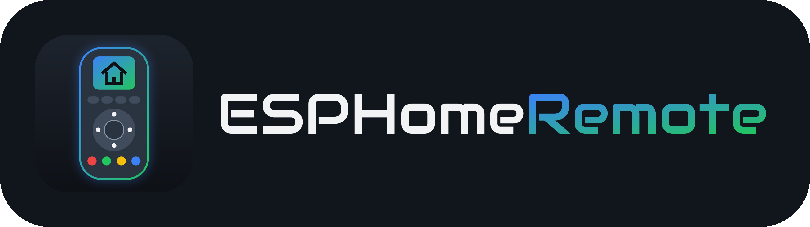
</p>

<h3 align="center">The remote your smart home deserves.</h3>

<p align="center">
  Touch display · Bluetooth · Infrared · Voice · a docking station that ties it all together.<br>
  Set up entirely in your browser inside Home Assistant – <b>no code, no YAML editing</b>.
</p>

<p align="center">
  <a href="https://github.com/Aggro600/ESPHomeRemote/releases"></a>
  <a href="https://my.home-assistant.io/redirect/hacs_repository/?owner=Aggro600&repository=ESPHomeRemote&category=integration"></a>
  
  
  <a href="https://github.com/Aggro600/ESPHomeRemote/blob/master/LICENSE"></a>
</p>

<p align="center">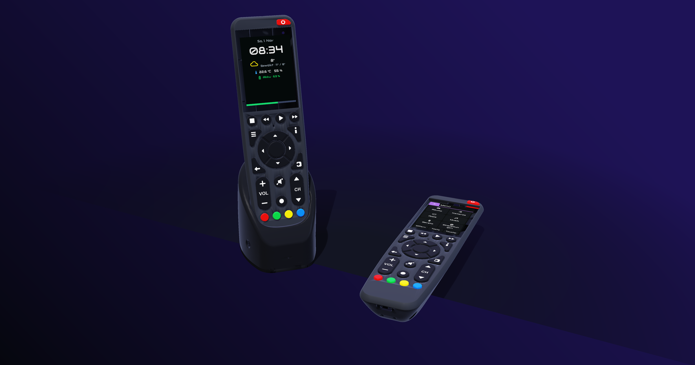<br>
<sub>Rendered from the 3D model of the hardware (<a href="https://github.com/LORDSn1per/OpenRemote-Hardware">OpenRemote Rev6</a>, GPL-3.0) – the screens show this firmware.</sub></p>

<p align="center">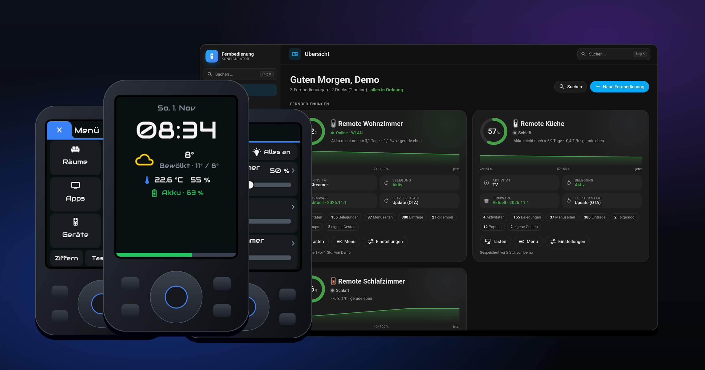</p>

<p align="center">
  <a href="#quick-start"><b>▶ Get started in 30 minutes</b></a> &nbsp;·&nbsp;
  <a href="https://aggro600.github.io/ESPHomeRemote/showcase/"><b>🧊 See it in 3D</b></a> &nbsp;·&nbsp;
  <a href="https://github.com/Aggro600/ESPHomeRemote/blob/master/CHANGELOG.md"><b>✨ What's new</b></a>
</p>

> **Language:** the configurator, the integration, the remote's display and the TV menu are available in
> **English and German** – Home Assistant's language applies. A few screenshots and page names in this guide are
> still German; the English meaning is given next to them.

---

<table>
<tr>
<td width="33%" valign="top">

### 🖱️ No code, ever
Keys, menus, home screens, popups and widgets – all in a polished configurator in your Home Assistant sidebar,
on PC and phone. Changes reach the remote in seconds.

</td>
<td width="33%" valign="top">

### ⚡ Instant, even from sleep
The docking station relays keys, commands and state by radio. Wake the remote with a key press – the key
reaches the dock in about **0.2 s**, long before the display is on.

</td>
<td width="33%" valign="top">

### 🔋 Weeks on one charge
Deep sleep with smart wake-up: lift it, tap it or press any key. Wi-Fi only when it is really needed –
the dock does the rest.

</td>
</tr>
</table>

---

## One remote for everything

<p align="center">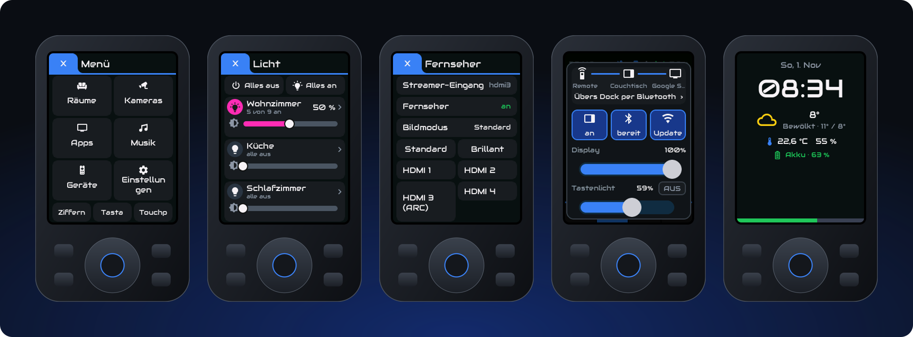</p>

- **TVs, streamers, tablets and PCs via Bluetooth** – four devices, switched by *activities* like a Harmony,
  as keys, **mouse (touchpad)** or **keyboard**.
- **Infrared for everything else** – about 270,000 devices from the Flipper IRDB and the Logitech Harmony
  archive, plus your own learned codes.
- **Your smart home on the display** – lights with sliders and colours, covers, sensors, cameras, scenes,
  doorbell popups.
- **Voice assistant** – Google on the TV or Home Assistant Assist, with the built-in microphone (also via the dock, Wi-Fi stays off).
- **Announcements** – hold a key, speak, and it plays on your speakers (e.g. a Cast group) with a chime.
- **Motion gestures** – shake, tilt, or teach your own (circle, swipe …).
- **Your menu on the TV** – the same tile menu as on the remote, as an overlay on any Android TV streamer,
  operated with the TV's own remote. Plus camera picture-in-picture and soundbar on/off via HDMI-CEC.

## Configure everything in your browser

<p align="center"></p>

The **Fernbedienung** (remote) page in your Home Assistant sidebar shows every remote and dock at a glance –
battery with 24 h history, connection, firmware and hints with a button to fix them.

<table>
<tr>
<td width="50%">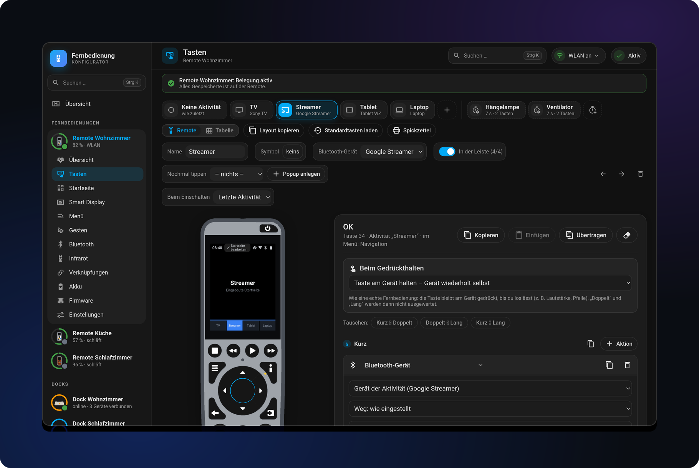</td>
<td width="50%">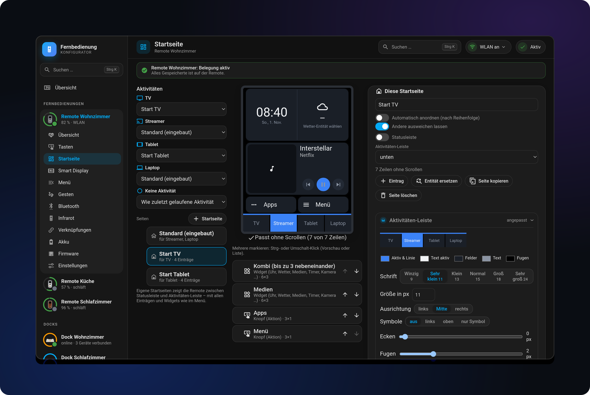</td>
</tr>
<tr>
<td valign="top"><b>Every key, your way</b> – tap a key on the virtual remote and add actions for short, double and
long press: Bluetooth, Home Assistant, infrared, 433 MHz or remote functions. Different per activity.</td>
<td valign="top"><b>Home screens per activity</b> – clock, weather, media, timer, camera and light widgets on a
grid, with a live preview that looks exactly like the display.</td>
</tr>
</table>

## A smart display in the dock

<p align="center">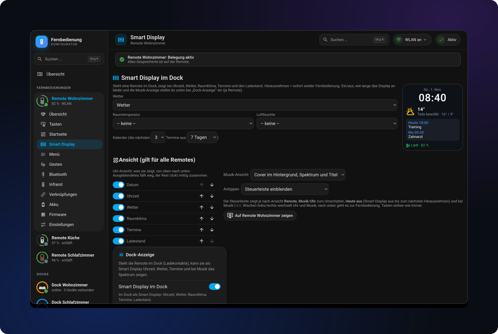</p>

Put the remote in its dock and it becomes a bedside or coffee-table display: **time, weather, room climate,
appointments and battery** – you pick the parts and their order. When music plays it switches to a
**spectrum analyser**, optionally over the album cover. Tap the screen for a **control bar**: back to the
remote, music ⇄ clock, ⏮ ⏯ ⏭ – or *Heute aus* (off until you take it out of the dock).

## On the TV: menu, cameras, soundbar

With the **ESPHomeRemote Streamer** app (ships with the integration, installed from the configurator over ADB) an
Android TV streamer – Google TV Streamer, MagentaTV Stick or any other Android TV device – becomes part of your setup:

- **TV menu** – build a menu with the same editor as for the remote (pages, tiles, lights, scenes, covers, cameras,
  volume, door openers with a yes/no prompt) and open it on the TV with a key of the streamer's remote or from Home
  Assistant (`esphomeremote.streamer_menu`). Size from 30 % to full screen, nine positions, display time adjustable.
- **Camera on the TV** – picture-in-picture over whatever is playing, on several TVs, with size, corner and display
  time – fixed in the configurator or per call (`esphomeremote.camera_tv` with `size`, `position`, `seconds`).
- **Soundbar via HDMI-CEC** – turn the soundbar or AV receiver on the TV's HDMI-ARC on and off through the streamer,
  no infrared needed (`switch.…_soundbar`, `esphomeremote.streamer_cec`).
- **Now playing** – title, cover, position and the on-screen keyboard of every app with a media session.

## Opening apps, made easy

<p align="center">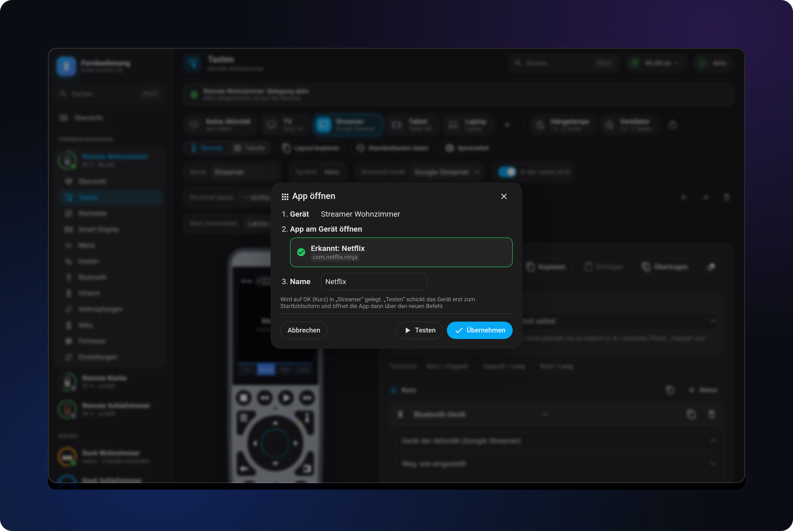</p>

Want a key that opens Netflix? Open the app on your TV once – the assistant **recognises it**, suggests the
name and creates the command. Test it with one click. Works right where you need it: in the key editor and in
every menu or popup.

## Always know how it connects

<table>
<tr>
<td width="34%" align="center">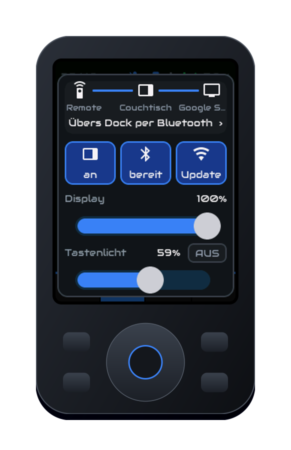</td>
<td width="66%">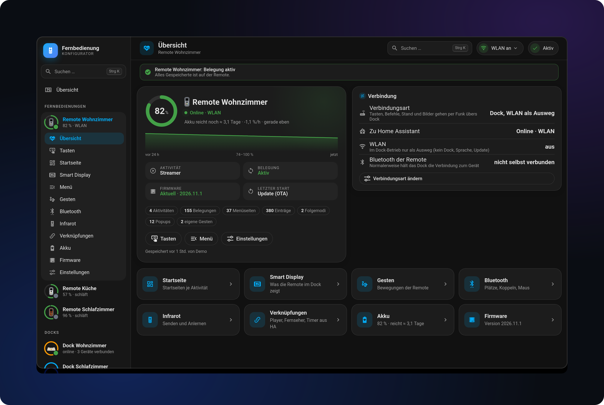</td>
</tr>
<tr>
<td valign="top"><b>Quick settings</b> show the live radio path: remote → dock → device, each link blue when
it works, red when it doesn't. Separate switches for dock mode, Bluetooth and Wi-Fi.</td>
<td valign="top"><b>Per-remote overview</b> – connection, battery, firmware and shortcuts to every page.</td>
</tr>
</table>

## The docking station

<table>
<tr>
<td width="50%">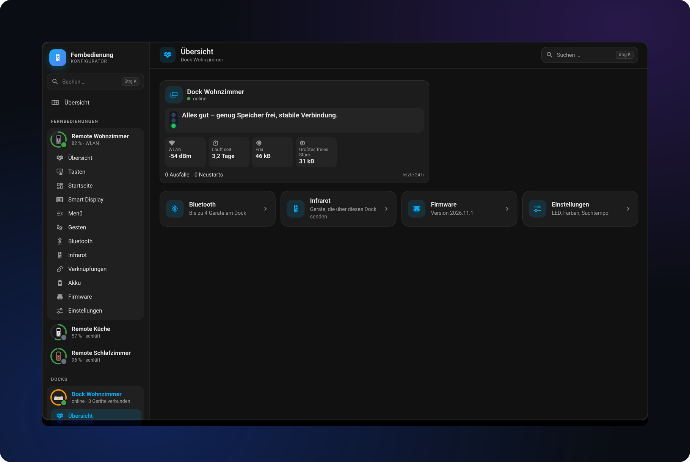</td>
<td width="50%">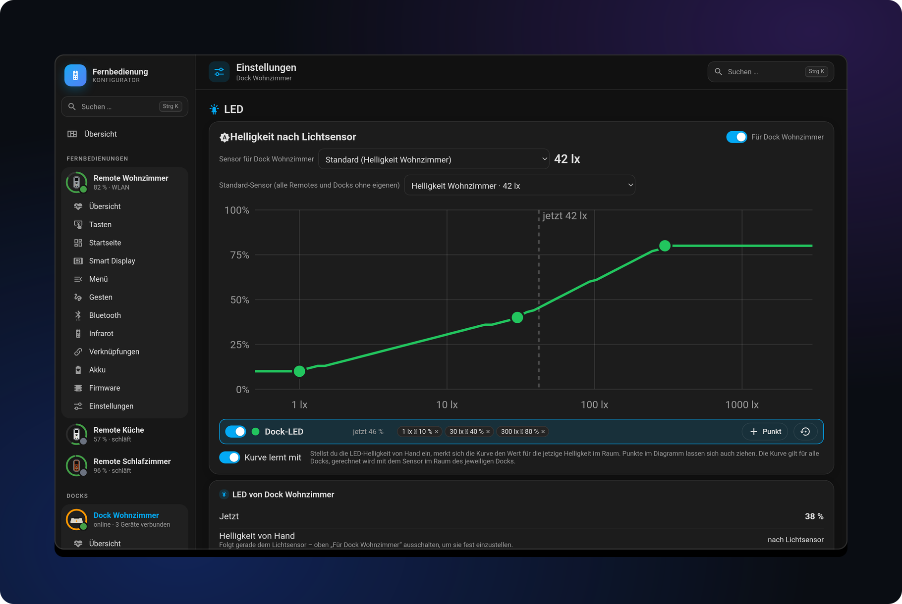</td>
</tr>
<tr>
<td valign="top"><b>The hub</b> (ESP32-C3) – keeps up to four Bluetooth devices connected, is an <b>IR blaster</b>
and <b>433 MHz</b> transmitter for Home Assistant, and relays everything for the remote by radio.</td>
<td valign="top"><b>Lights that follow the room</b> – display, key backlight and dock LED adjust to a light
sensor. Drag the curve; it learns while you adjust.</td>
</tr>
</table>

## More highlights

<table>
<tr>
<td width="50%">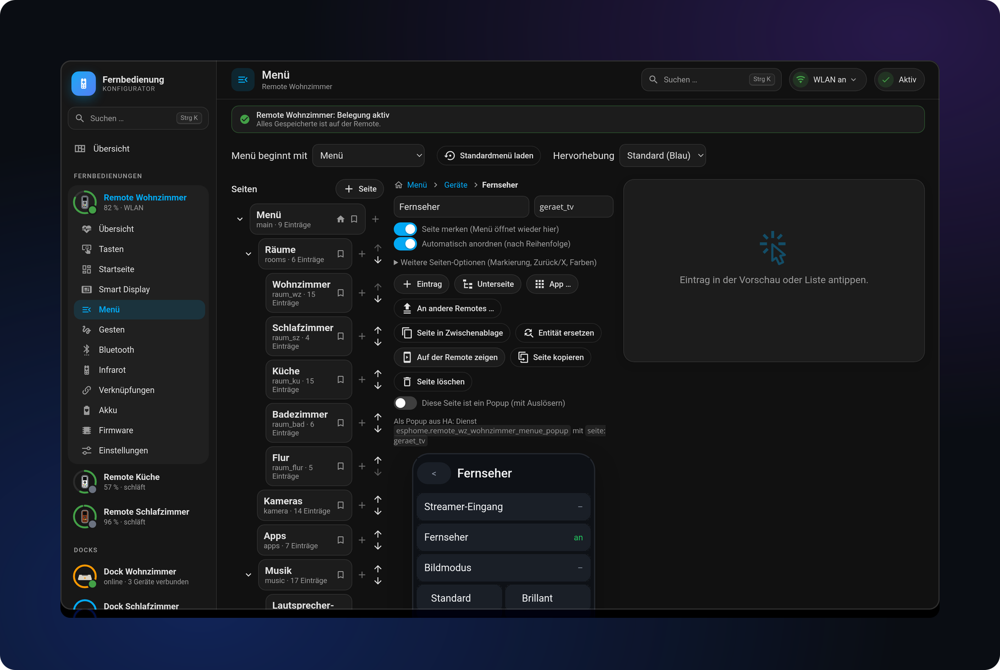</td>
<td width="50%">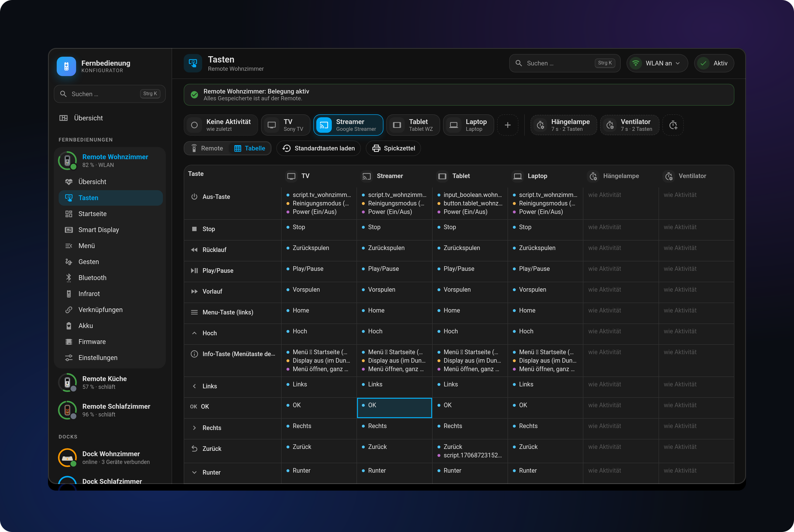</td>
</tr>
<tr>
<td valign="top"><b>Menu editor</b> – pages, sub-pages and popups that open by themselves (doorbell, sleep
timer, picture mode …). Send a page to your other remotes with one click.</td>
<td valign="top"><b>Table view</b> – all activities and follow-up modes side by side.</td>
</tr>
<tr>
<td>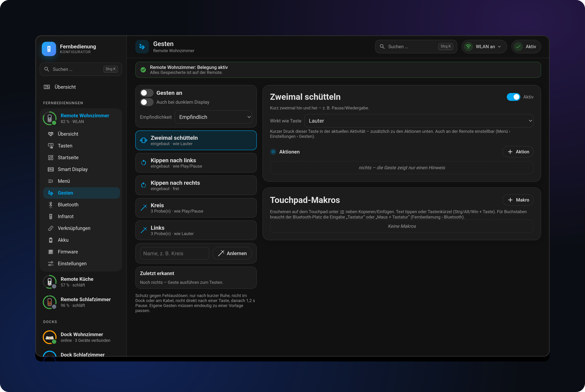</td>
<td>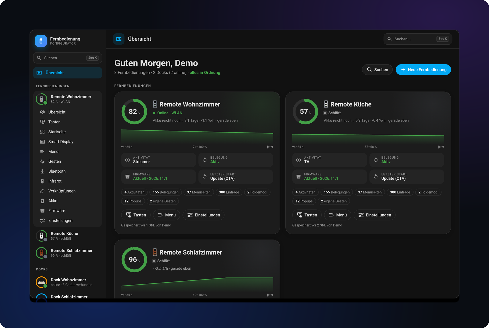</td>
</tr>
<tr>
<td valign="top"><b>Gestures</b> – built-in and your own, recognised however you hold the remote.</td>
<td valign="top"><b>Search (Ctrl+K)</b> – finds every key, setting and menu page.</td>
</tr>
<tr>
<td align="center">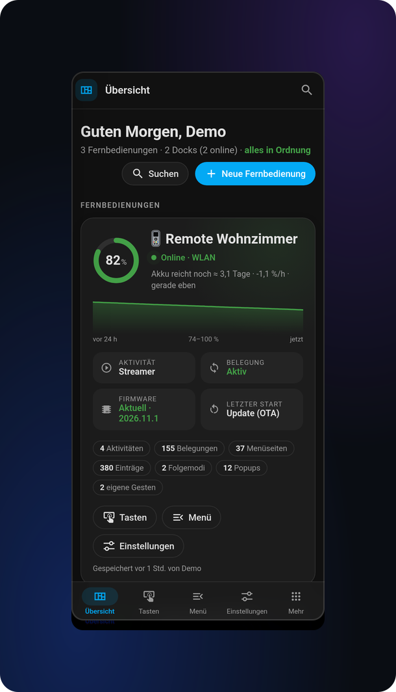 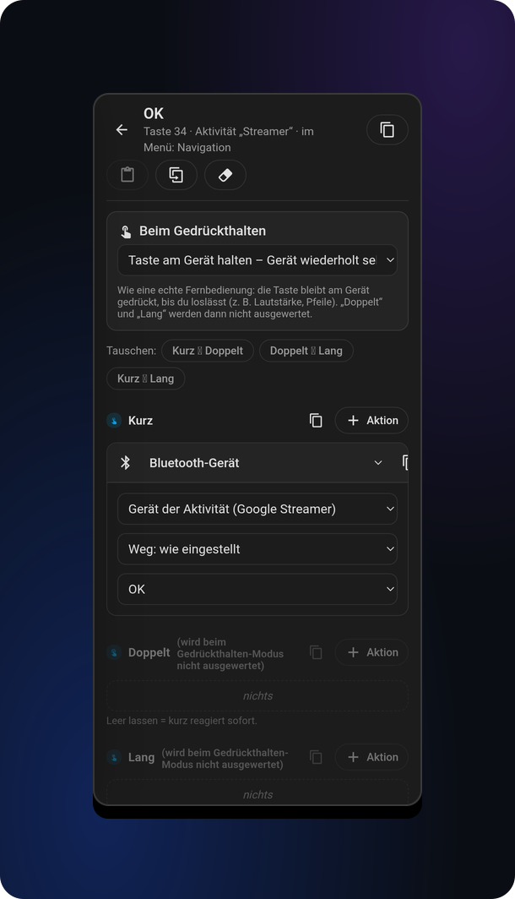</td>
<td>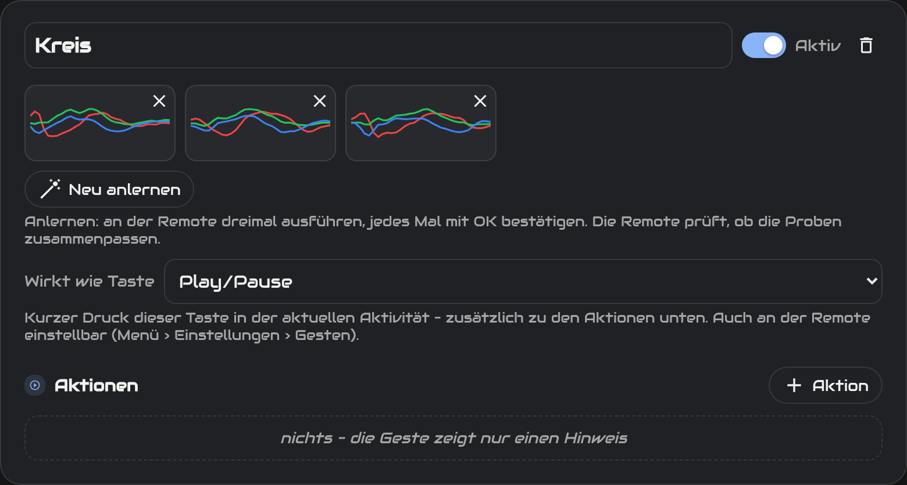</td>
</tr>
<tr>
<td valign="top"><b>On your phone</b> – the full configurator, made for small screens.</td>
<td valign="top"><b>Teach a gesture</b> – perform it three times, done.</td>
</tr>
</table>

<details>
<summary><b>Full feature list</b></summary>

**Remote control**
- **Controls TVs, streamers, tablets and PCs via Bluetooth** – 4 devices, switched by "activities" like a Harmony.
  Per device: keys only, **mouse (touchpad)**, **keyboard** or both.
- **Every key freely assignable** – short, double and long press separately, different per activity, with hold
  and repeat. Plus steps **when starting/ending** an activity (turn the TV on, pick the input …).
- **Follow-up modes** – after an action, other keys apply for a few seconds (e.g. channel +/− dims the lamp).
- **Motion gestures** – shake twice, tilt, and **teach your own gestures** (circle, swipe …): the shape is
  recognised no matter how large or fast, or how you hold the remote.
- **Touchpad** – the display becomes a mouse, with scroll strip, click buttons and shortcut macros.
- **Infrared** – about 270,000 devices from the Flipper IRDB and the Logitech Harmony archive (kept up to date from
  GitHub), **learn** and manage your own codes; send through the remote, the dock or other IR blasters in Home
  Assistant (Broadlink …).
- **Voice assistant** – Google on the TV or Home Assistant Assist.

**Display & smart home**
- **Your own menu** – pages, tiles, light sliders, covers, sensors and camera images, freely arranged on a grid,
  plus **popups** that open by themselves ("someone rang the doorbell", sleep timer, picture mode for Netflix …).
- **Home screen per activity** – with widgets: clock, weather with forecast, media player, timer, camera.
- **Smart display in the dock** – while docked, the remote shows time, weather, room climate, appointments and
  battery level.
- **Brightness from the light sensor** – display, key backlight and dock LED follow the room light; the curve
  learns as you adjust it.
- **Camera and doorbell** – image on the remote, camera on the TV (four sizes, five positions, several TVs).
- **TV menu** – your tile menu as an overlay on Android TV streamers, plus soundbar on/off via HDMI-CEC.
- **Long battery life** – deep sleep, wakes up when lifted, tapped or a key is pressed; the wake-up key and
  everything pressed during start-up still arrives.

**Docking station (optional, ESP32-C3)**
- **IR blaster for Home Assistant** – every IR device becomes a media player, a remote entity
  (`remote.send_command` with Harmony command names) and a button per command. Plus **433 MHz** (CC1101).
- **Activity switches** – one switch per remote and activity in Home Assistant.
- **Radio bridge to Home Assistant** – key commands, state (player, TV, timer) and cover art go encrypted via
  ESP-NOW through the dock: right after waking up, without the remote having to connect first.
  Selectable in the configurator: **Wi-Fi**, **Bluetooth**, **Dock + Bluetooth** or **Dock, power saving**.
- **No dock? Use any ESP32** – an ESP32, ESP32-S3, ESP32-C6 or a bare ESP32-C3 can stand in for the dock: Bluetooth
  proxy for the remote, Bluetooth keyboard for the TV and the radio bridge work, IR, 433 MHz, LEDs and charging
  contacts are missing. Flash it from the configurator over USB – the chip is detected automatically.

**Configurator in Home Assistant** – everything in the browser, on PC and phone:
overview with battery history, **search with Ctrl+K**, table of all keys, change list with undo, backup,
**firmware updates over Wi-Fi** (can be queued while the remote sleeps) and **USB flashing in the browser**.
Settings sync both ways: what you change on the remote shows up in the configurator.

</details>

---

## What you need

| | |
|---|---|
| 🎛️ **The remote** | **OMOTE / Open Remote, board Rev6** (ESP32-S3) – hardware: [OMOTE-Hardware](https://github.com/OMOTE-Community/OMOTE-Hardware). PCBs are sometimes offered in the [Discord](https://discord.com/invite/5PnYFAsKsG) buy/sell channel. |
| 🏠 **Home Assistant** | 2026.9 or newer, with the **ESPHome Device Builder** add-on and **[HACS](https://hacs.xyz)**. |
| 🔌 **For the first flash** | A **USB-C data cable** (not a charge-only cable) and a PC with **Chrome or Edge**. |
| 📶 **Wi-Fi** | A **2.4 GHz** network (the ESP32 can't use 5 GHz). |
| 🧲 **Docking station** | *Optional.* Original dock or any spare ESP32 – see [The docking station](#the-docking-station). |

---

## Quick start

About **30 minutes**, most of it waiting for the first build. You never edit code – you copy one file and one block of text.

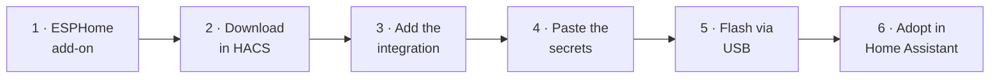

### 1 · Install ESPHome
In Home Assistant: *Settings → Add-ons → Add-on Store* → **ESPHome Device Builder** → **Install** → **Start**.
Already installed? Skip ahead.

### 2 · Download ESPHomeRemote from HACS
ESPHomeRemote is in the **official HACS list** – no custom repository needed.

[](https://my.home-assistant.io/redirect/hacs_repository/?owner=Aggro600&repository=ESPHomeRemote&category=integration)

1. Click the button above – or open **HACS**, search for **ESPHomeRemote**.
2. **Download** → confirm.
3. **Restart** Home Assistant (*Settings → System → ⏻ top right → Restart*).

> *Not found?* In HACS **⋮ → Reload**, or update HACS first.

### 3 · Add the integration

[](https://my.home-assistant.io/redirect/config_flow_start/?domain=esphomeremote)

1. Click the button – or *Settings → Devices & services → **+ Add integration*** → **ESPHomeRemote**.
2. Leave both fields as they are (remote name `esphomeremote`, the key is generated) → **Submit**.
3. The next screen shows a **ready-made block** like this – **copy it** (keep the window open):
   ```yaml
   ota_pw: "…"
   ap_password: "…"
   direkt_schluessel: "…"
   esphomeremote_key: "…"
   ```
   The passwords and the radio key for the dock are generated for you.

### 4 · Paste the secrets into ESPHome
1. Open the **ESPHome** add-on → **Secrets** (top right).
2. Paste the block **below** your Wi-Fi lines. If there are none yet, add them too:
   ```yaml
   wifi_ssid: "your Wi-Fi name"
   wifi_password: "your Wi-Fi password"
   ```
3. **Save**.

### 5 · Flash the remote
1. In ESPHome: **+ New device** → **Continue** → **Skip** (or *Create empty*) – any name.
2. Open the new device with **Edit**, delete everything and paste the contents of
   **[`esphomeremote.yaml`](https://github.com/Aggro600/ESPHomeRemote/blob/master/esphomeremote.yaml)** (use *Copy raw file* on GitHub).
   Change nothing – the remote finds Home Assistant by itself.
3. **Save** → **Install** → **Plug into this computer** → connect the remote by USB-C → pick it in the list → **Connect**.
4. The first build takes about **10 minutes**. ☕ The remote restarts when it's done.

> **"Plug into this computer" isn't offered or no device shows up?** See [Troubleshooting](#troubleshooting).

### 6 · Adopt it in Home Assistant
1. Home Assistant shows **New device discovered** (*Settings → Devices & services*) → **Add** → **Submit**.
2. On that ESPHome device: **Configure** → turn on **Allow the device to perform Home Assistant actions** → **Submit**.
3. 🎉 Done. In the sidebar you now find **Remote** (*Fernbedienung*) – everything else is set up there.

### First steps in the configurator
1. **Pair Bluetooth:** on the remote *Menu → Settings → Bluetooth* → pick a slot → *Pair new*, then on the TV/streamer
   search for Bluetooth devices and choose **ESPHomeRemote**.
2. **Keys:** in the configurator open your remote → **Keys** – tap a key on the virtual remote and choose what it does.
3. **Save** (or Ctrl+S). A sleeping remote picks up the change the next time it wakes up.

Want the dock, the TV menu or more remotes? Read on below – or just explore: every page in the configurator explains itself.

---

### Docking station (optional)
In the configurator: **Workshop → New dock** creates the device file and flashes it over USB – the chip is detected
automatically. The dock uses the same secrets as the remote.

### Streamer app (optional)

For the TV menu, camera on the TV, soundbar via HDMI-CEC, title, cover art and the keyboard popup from an Android TV
streamer: enable developer options and USB debugging on the streamer, add the **Android Debug Bridge** integration
with its IP in Home Assistant, then in the configurator *Wiedergabe (playback) → Streamer anlegen (add streamer)* →
**Einrichten (set up)**. The app ships with the integration; updating and uninstalling work the same way. On the TV,
"ESPHomeRemote Streamer" shows whether everything is running. Each streamer card then has **Menu on the TV** (key,
size, position, display time, **Edit menu**) and **Soundbar / AV receiver via HDMI**. Details: [streamer-app/README.md](https://github.com/Aggro600/ESPHomeRemote/blob/master/streamer-app/README.md).

### Updates

- **Configurator:** Home Assistant announces new versions like any HACS integration (*Settings → Updates*),
  with the list of what's new. Install, restart Home Assistant – done.
- **Remotes and docks:** afterwards the configurator shows "Neue Version …" (new version) under *Firmware* –
  **Alle aktualisieren** (update all) builds and flashes them (touch sleeping remotes briefly).
- **Installed before 2026.11.5.4?** Flash each remote **once via USB cable** (*Firmware* page of the remote → **USB**,
  Chrome or Edge): the faster wake-up needs a new bootloader, which can't be updated over Wi-Fi. Wi-Fi updates keep
  working without it – the remote just wakes about 0.5 s slower. New installations already have it.
- The firmware comes from the `stabil` branch (latest release).
- What's new: [CHANGELOG.md](https://github.com/Aggro600/ESPHomeRemote/blob/master/CHANGELOG.md).


## The configurator

In the sidebar, **"Fernbedienung"** (remote) – on phone and PC. On the left are your remotes and docks; open one
to see its pages:

**Per remote**

| Page | What you do there |
|---|---|
| **Übersicht** (overview) | Status, connection (dock, Wi-Fi, Bluetooth), firmware and shortcuts to every page. |
| **Tasten** (keys) | Every key per activity: short / double / long. Bluetooth, Home Assistant, infrared, 433 MHz, remote functions, the **app assistant**. Activities, follow-up modes, table view, popup when you tap the running activity again. |
| **Startseite** (home screen) | A home screen per activity with entries and widgets – or adjust the built-in one. What tapping the cover opens. Send it to other remotes. |
| **Smart Display** | What the remote shows in the dock: parts and order, music view (spectrum, title, cover), control bar, on/off times. |
| **Menü** (menu) | Pages, sub-pages and popups (doorbell, timer, picture mode …) on a grid with preview. Send pages to other remotes. |
| **Gesten** (gestures) | Shake, tilt and custom gestures; touchpad macros. |
| **Bluetooth / Infrarot** (infrared) | Pair slots, input mode per device, IR route (remote, dock, other IR blasters). |
| **Verknüpfungen** (links) | Which Home Assistant devices the remote uses: "now playing" player, TV, multiroom, speaker for the assistant, streamer, timers. |
| **Akku** (battery) | History, consumption per state, charges, why it didn't sleep. |
| **Firmware** | Version, update over Wi-Fi or USB. |
| **Einstellungen** (settings) | All remote settings, applied immediately; radio overview "Welcher Funk wofür?" (which radio for what). |

**Per dock:** Übersicht · Bluetooth (devices at the dock) · Infrarot (IR devices) · Firmware · Einstellungen (LED,
colours, scan speed).

**For the whole home:** **IR-Codes** (IR databases and your own codes) · **Abgleich** (keep remotes in sync,
compare two remotes) · **Prüfen & Finden** (check everything, find where an entity is used) · **Werkstatt**
(workshop: updates for all devices, new remote or dock, backup, board test).

**Speichern** (save, or Ctrl+S) sends everything to the remote – if it's asleep, it picks it up the next time it
wakes up.

---

## Operation in brief

- **Menu key**: open / close the menu. Double press: display off.
- **D-pad + OK**: move around in the menu; on the home screen it controls the active device.
- **Back**: one page back, closes popups.
- **Bar at the bottom of the home screen**: switch between TV, streamer etc.
- **Pair Bluetooth**: Menu → Einstellungen (settings) → Bluetooth → pick a slot → "Neu koppeln" (pair new),
  then search for "ESPHomeRemote" on the TV / streamer.

---

## Troubleshooting

| Problem | Solution |
|---|---|
| **"Plug into this computer" is missing or greyed out** | The browser only allows USB from a secure (https) page. Open Home Assistant via https (e.g. Home Assistant Cloud) – or choose **Install → Manual download**, then flash the file at [web.esphome.io](https://web.esphome.io) in Chrome or Edge. |
| **No device in the USB list** | Use a USB-C **data** cable and a different port. |
| **Build fails with "Secret … not defined"** | A line is missing in the ESPHome **Secrets** – compare with step 4. The names must match exactly. |
| **Remote isn't discovered after flashing** | Is the Wi-Fi **2.4 GHz**, and are name and password in the secrets correct? If the remote can't connect, it opens its own hotspot after a while (password: `ap_password`). |
| **Keys don't switch anything in Home Assistant** | Step 6.2: *Allow the device to perform Home Assistant actions*. |
| **Configurator says "noch nicht übertragen" (not yet transferred)** | The remote is asleep – press a key once. Never works? `esphomeremote_key` in the ESPHome secrets must match the key under *ESPHomeRemote → Configure*. |
| **Lost the block from step 3** | *ESPHomeRemote → Configure* shows the key again. For the other three lines you can choose your own values: two passwords, and 32 characters from `0-9 a-f` for `direkt_schluessel` (the same on all remotes and docks). |

Still stuck? [Open an issue](https://github.com/Aggro600/ESPHomeRemote/issues/new/choose) – the form asks for everything needed to help quickly.

---

## FAQ

**Several remotes?**
Easiest: in the configurator **Workshop → New remote**. By hand: another device in ESPHome with the same
`esphomeremote.yaml`, but change `device_name`, `friendly_name` and `ha_name` at the top (e.g. `esphomeremote-2`,
`ESPHomeRemote 2`, `esphomeremote_2`). Then add the new name under *ESPHomeRemote →* **Configure**, separated by a comma.

**Pages show "nicht verfügbar" (unavailable).**
Some built-in pages (home screen player, doorbell, sleep timer) need entities. Choose them in the configurator
under *Verknüpfungen* (links) – no firmware change needed.

**Camera on the TV** (optional):
in the configurator under **Funktionen → Kamera auf dem Fernseher** (camera on the TV) – shown by the streamer app as
an overlay, on one or several TVs, each with its own camera list, size and corner. From automations:
`esphomeremote.camera_tv` with `camera:` (`camera.xyz`, `last`, `next`, `previous`, `off`) and optionally `size:`,
`position:` and `seconds:` for that one call. That is also where you set up the TV input (for popups like "only if
TV input is not HDMI 3") and restarts via ADB.

**Open the TV menu from a remote key:** assign the action `esphomeremote.streamer_menu` with `streamer: <name>`
(optional `command: toggle/open/close`, `page:`, `size:`, `position:`).

<details>
<summary><b>Own fixed API key instead of the OTA password</b> (advanced)</summary>

The firmware protects updates with `ota_pw`, because Home Assistant
hands out the API key only when the device is added. If you set a fixed key yourself, ESPHome warns that the password
"wastes flash and RAM". Then add this to your device YAML (keep the `ota_pw` secret – `esphomeremote.yaml` still references it, the value is just no longer used):
```yaml
api:
  encryption:
    key: !secret api_key
ota:
  - id: !extend ota_esphome
    password: !remove
    encryption: {}
```

</details>

---

## For developers

- `esphomeremote-firmware.yaml` is generated from the developer version (`tools/publish.py` in the
  developer setup) – please make changes there, not here.
- Custom components in `components/`: display (`ili9341_i80`), keypad (`tca8418`), battery gauge
  (`max17048`), motion sensor (`lis3dh`), Bluetooth HID (`espidf_ble_keyboard`, `atv_voice`),
  configurator (`key_config`, `menu`), SD card, touch (`ft63x6`).
- `custom_components/esphomeremote`: integration with panel (`frontend/configurator.js`), delivers the
  assignment to the remote over HTTP.
- Code comments and the developer notes in `docs/development/` are in German.

**Developer version (1:1 as in use)** – in addition to the simple version above, this repository contains
everything the remotes are actually built with:
- `templates/remote.yaml` (firmware) and `templates/remote-halink.yaml` (Bluetooth layer "Bluetooth only",
  HA via BLE/dock – this file is flashed), `templates/dock-base.yaml` (docking station = `dock-core.yaml` + `dock-board.yaml`; a dock stand-in on another ESP32 uses only the core),
  `remote-dev-tests.yaml` (test tools, can be turned off).
- `tools/remotes.py` generates `remote-wz-<name>.yaml` and `remote-wz-<name>-halink.yaml` per remote
  (list in `tools/remotes.json`, IP secret `ip_remote_wz_<name>`). Build/flash: `tools/esphome_run.mjs`.
  For these remotes the integration runs a Bluetooth bridge at `127.0.0.1:<port>` (from 16053). It does not change
  ESPHome's config entries itself: if an entry points elsewhere, a repair issue names host and port; set them via
  ESPHome → Reconfigure, or with "Point ESPHome entries to the bridge" in the configurator (Firmware, asks first).
- `components/ha_tunnel`, `components/network` (Bluetooth layer), `components/dock_direct`, `dock_hid`,
  `bluetooth_connection` (dock), `custom_components/esphomeremote/ble_link.py` (HA counterpart of the
  Bluetooth layer), `home-assistant/packages/` (YAML alternative to the integration), `docs/development/` (architecture, radio
  concept, measurements).

## License

MIT, see [LICENSE](https://github.com/Aggro600/ESPHomeRemote/blob/master/LICENSE). Third-party assets: [THIRD-PARTY.md](https://github.com/Aggro600/ESPHomeRemote/blob/master/THIRD-PARTY.md).
