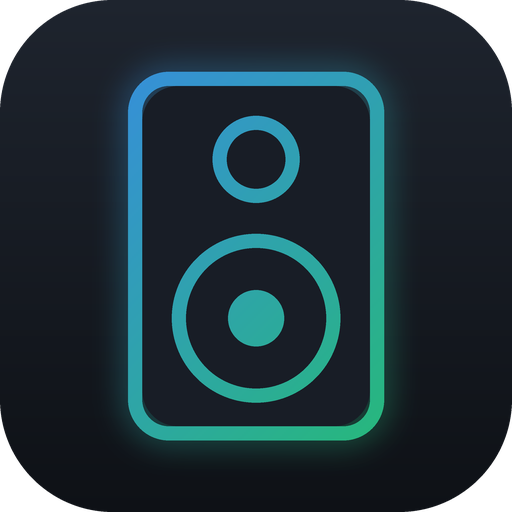

<p align="center"><b>🇬🇧 English</b> · 🇩🇪 <a href="README.de.md">Deutsch</a></p>

<p align="center">
  <picture>
    <source media="(prefers-color-scheme: dark)" srcset="docs/bilder/logo-dunkel.png">
    
  </picture>
</p>

<h3 align="center">The remote your smart home deserves.</h3>

<p align="center">
  Touch display · Bluetooth · Infrared · Voice · a docking station that ties it all together.<br>
  Set up entirely in your browser inside Home Assistant – <b>no code, no YAML editing</b>.
</p>

<p align="center">
  <a href="https://github.com/Aggro600/ESPHomeRemote/releases"></a>
  <a href="https://hacs.xyz"></a>
  
  
  <a href="LICENSE"></a>
</p>

<p align="center"><br>
<sub>Rendered from the 3D model of the hardware (<a href="https://github.com/LORDSn1per/OpenRemote-Hardware">OpenRemote Rev6</a>, GPL-3.0) – the screens show this firmware.</sub></p>

<p align="center"></p>

<p align="center">
  <a href="#quick-start"><b>▶ Get started in 30 minutes</b></a> &nbsp;·&nbsp;
  <a href="https://aggro600.github.io/ESPHomeRemote/showcase/"><b>🧊 See it in 3D</b></a> &nbsp;·&nbsp;
  <a href="CHANGELOG.md"><b>✨ What's new</b></a>
</p>

> **Language:** the configurator and the texts on the remote are currently in **German**. This guide gives the
> German names as they appear on screen, with the English meaning next to them.

---

<table>
<tr>
<td width="33%" valign="top">

### 🖱️ No code, ever
Keys, menus, home screens, popups and widgets – all in a polished configurator in your Home Assistant sidebar,
on PC and phone. Changes reach the remote in seconds.

</td>
<td width="33%" valign="top">

### ⚡ Instant, even from sleep
The docking station relays keys, commands and state by radio. Wake the remote with a key press – the key is
already on its way before the display is on.

</td>
<td width="33%" valign="top">

### 🔋 Weeks on one charge
Deep sleep with smart wake-up: lift it, tap it or press any key. Wi-Fi only when it is really needed –
the dock does the rest.

</td>
</tr>
</table>

---

## One remote for everything

<p align="center"></p>

- **TVs, streamers, tablets and PCs via Bluetooth** – four devices, switched by *activities* like a Harmony,
  as keys, **mouse (touchpad)** or **keyboard**.
- **Infrared for everything else** – about 270,000 devices from the Flipper IRDB and the Logitech Harmony
  archive, plus your own learned codes.
- **Your smart home on the display** – lights with sliders and colours, covers, sensors, cameras, scenes,
  doorbell popups.
- **Voice assistant** – Google on the TV or Home Assistant Assist, with the built-in microphone.
- **Motion gestures** – shake, tilt, or teach your own (circle, swipe …).

## Configure everything in your browser

<p align="center"></p>

The **Fernbedienung** (remote) page in your Home Assistant sidebar shows every remote and dock at a glance –
battery with 24 h history, connection, firmware and hints with a button to fix them.

<table>
<tr>
<td width="50%"></td>
<td width="50%"></td>
</tr>
<tr>
<td valign="top"><b>Every key, your way</b> – tap a key on the virtual remote and add actions for short, double and
long press: Bluetooth, Home Assistant, infrared, 433 MHz or remote functions. Different per activity.</td>
<td valign="top"><b>Home screens per activity</b> – clock, weather, media, timer, camera and light widgets on a
grid, with a live preview that looks exactly like the display.</td>
</tr>
</table>

## A smart display in the dock

<p align="center"></p>

Put the remote in its dock and it becomes a bedside or coffee-table display: **time, weather, room climate,
appointments and battery** – you pick the parts and their order. When music plays it switches to a
**spectrum analyser**, optionally over the album cover. Tap the screen for a **control bar**: back to the
remote, music ⇄ clock, ⏮ ⏯ ⏭ – or *Heute aus* (off until you take it out of the dock).

## Opening apps, made easy

<p align="center"></p>

Want a key that opens Netflix? Open the app on your TV once – the assistant **recognises it**, suggests the
name and creates the command. Test it with one click. Works right where you need it: in the key editor and in
every menu or popup.

## Always know how it connects

<table>
<tr>
<td width="34%" align="center"></td>
<td width="66%"></td>
</tr>
<tr>
<td valign="top"><b>Quick settings</b> show the live radio path: remote → dock → device, each link blue when
it works, red when it doesn't. Separate switches for dock mode, Bluetooth and Wi-Fi.</td>
<td valign="top"><b>Per-remote overview</b> – connection, battery, firmware and shortcuts to every page.</td>
</tr>
</table>

## The docking station

<table>
<tr>
<td width="50%"></td>
<td width="50%"></td>
</tr>
<tr>
<td valign="top"><b>The hub</b> (ESP32-C3) – keeps up to four Bluetooth devices connected, is an <b>IR blaster</b>
and <b>433 MHz</b> transmitter for Home Assistant, and relays everything for the remote by radio.</td>
<td valign="top"><b>Lights that follow the room</b> – display, key backlight and dock LED adjust to a light
sensor. Drag the curve; it learns while you adjust.</td>
</tr>
</table>

## More highlights

<table>
<tr>
<td width="50%"></td>
<td width="50%"></td>
</tr>
<tr>
<td valign="top"><b>Menu editor</b> – pages, sub-pages and popups that open by themselves (doorbell, sleep
timer, picture mode …). Send a page to your other remotes with one click.</td>
<td valign="top"><b>Table view</b> – all activities and follow-up modes side by side.</td>
</tr>
<tr>
<td></td>
<td></td>
</tr>
<tr>
<td valign="top"><b>Gestures</b> – built-in and your own, recognised however you hold the remote.</td>
<td valign="top"><b>Search (Ctrl+K)</b> – finds every key, setting and menu page.</td>
</tr>
<tr>
<td align="center"> </td>
<td></td>
</tr>
<tr>
<td valign="top"><b>On your phone</b> – the full configurator, made for small screens.</td>
<td valign="top"><b>Teach a gesture</b> – perform it three times, done.</td>
</tr>
</table>

<details>
<summary><b>Full feature list</b></summary>

**Remote control**
- **Controls TVs, streamers, tablets and PCs via Bluetooth** – 4 devices, switched by "activities" like a Harmony.
  Per device: keys only, **mouse (touchpad)**, **keyboard** or both.
- **Every key freely assignable** – short, double and long press separately, different per activity, with hold
  and repeat. Plus steps **when starting/ending** an activity (turn the TV on, pick the input …).
- **Follow-up modes** – after an action, other keys apply for a few seconds (e.g. channel +/− dims the lamp).
- **Motion gestures** – shake twice, tilt, and **teach your own gestures** (circle, swipe …): the shape is
  recognised no matter how large or fast, or how you hold the remote.
- **Touchpad** – the display becomes a mouse, with scroll strip, click buttons and shortcut macros.
- **Infrared** – about 270,000 devices from the Flipper IRDB and the Logitech Harmony archive (kept up to date from
  GitHub), **learn** and manage your own codes; send through the remote, the dock or other IR blasters in Home
  Assistant (Broadlink …).
- **Voice assistant** – Google on the TV or Home Assistant Assist.

**Display & smart home**
- **Your own menu** – pages, tiles, light sliders, covers, sensors and camera images, freely arranged on a grid,
  plus **popups** that open by themselves ("someone rang the doorbell", sleep timer, picture mode for Netflix …).
- **Home screen per activity** – with widgets: clock, weather with forecast, media player, timer, camera.
- **Smart display in the dock** – while docked, the remote shows time, weather, room climate, appointments and
  battery level.
- **Brightness from the light sensor** – display, key backlight and dock LED follow the room light; the curve
  learns as you adjust it.
- **Camera and doorbell** – image on the remote, camera on the TV (in three sizes).
- **Long battery life** – deep sleep, wakes up when lifted, tapped or a key is pressed; the wake-up key and
  everything pressed during start-up still arrives.

**Docking station (optional, ESP32-C3)**
- **IR blaster for Home Assistant** – every IR device becomes a media player, a remote entity
  (`remote.send_command` with Harmony command names) and a button per command. Plus **433 MHz** (CC1101).
- **Activity switches** – one switch per remote and activity in Home Assistant.
- **Radio bridge to Home Assistant** – key commands, state (player, TV, timer) and cover art go encrypted via
  ESP-NOW through the dock: right after waking up, without the remote having to connect first.
  Selectable in the configurator: **Wi-Fi**, **Bluetooth**, **Dock + Bluetooth** or **Dock, power saving**.
- **No dock? Use any ESP32** – an ESP32, ESP32-S3, ESP32-C6 or a bare ESP32-C3 can stand in for the dock: Bluetooth
  proxy for the remote, Bluetooth keyboard for the TV and the radio bridge work, IR, 433 MHz, LEDs and charging
  contacts are missing. Flash it from the configurator over USB – the chip is detected automatically.

**Configurator in Home Assistant** – everything in the browser, on PC and phone:
overview with battery history, **search with Ctrl+K**, table of all keys, change list with undo, backup,
**firmware updates over Wi-Fi** (can be queued while the remote sleeps) and **USB flashing in the browser**.
Settings sync both ways: what you change on the remote shows up in the configurator.

</details>

---

## What you need

- The remote: **OMOTE / Open Remote, board Rev6** (ESP32-S3).
  Hardware: https://github.com/OMOTE-Community/OMOTE-Hardware
  You may get PCBs via the Discord buy/sell channel: https://discord.com/invite/5PnYFAsKsG
- A **USB-C cable** and a PC with **Chrome or Edge** (for the first flash).
- For all features: **Home Assistant** with the **ESPHome** add-on ("ESPHome Device Builder")
  and **HACS** (for the configurator).

---

## Quick start

> **Web installer (without Home Assistant):** will return as soon as there is ready-built firmware to download.
> Until then, use the Home Assistant route below.

### With Home Assistant (recommended)

**Step 1 – Get ESPHome ready**
In Home Assistant: *Settings → Add-ons → Add-on Store →* install and start **ESPHome Device Builder**.

**Step 2 – Install the configurator (via HACS)**
1. If you don't have it yet: install **HACS** (https://hacs.xyz – once, 5 minutes).
2. Open **HACS** in Home Assistant → **⋮** at the top right → **"Custom repositories"**.
3. Paste `https://github.com/Aggro600/ESPHomeRemote` – type **"Integration"** → **Add**.
4. Search HACS for **"ESPHomeRemote"** → **Download**.
5. **Restart** Home Assistant (*Settings → System → ⏻ at the top right → Restart*).
6. *Settings → Devices & services →* **"+ Add integration"** → **"ESPHomeRemote"**.
   Keep the remote's name as it is (`esphomeremote`) → **Submit**.
7. A line like `esphomeremote_konfig_key: "…"` appears – **copy** it, you'll need it in a moment.

**Step 3 – Enter passwords**
In the ESPHome add-on, click **"Secrets"** at the top right and add these lines
(Wi-Fi is usually already there; the passwords are up to you):
```yaml
ota_pw: "a-password"
ap_password: "another-password"
direkt_schluessel: "…"             # 32 hex characters, e.g. from  openssl rand -hex 16  (radio link to the dock)
esphomeremote_konfig_key: "…"      # the line you copied in step 2
```

**Step 4 – Flash the remote**
1. In the ESPHome add-on: **"+ New device"** → **"Skip"** (or "Create empty").
2. Copy the contents of [`esphomeremote.yaml`](esphomeremote.yaml) into the editor – no changes needed
   (the remote finds Home Assistant's address by itself).
3. **Save** → **Install** → *"Plug into this computer"* → connect the remote via USB-C and select it.
   The first build takes about 10 minutes.

**Step 5 – Adopt it in Home Assistant**
1. Home Assistant reports *"New device discovered"* (*Settings → Devices & services*) → **Add**.
2. On the device, click **"Configure"** → turn on **"Allow the device to perform Home Assistant actions"**.
3. Done! In the sidebar you now have **"Fernbedienung"** (remote) – that's where you set up everything.

---

### Streamer app (optional)

For title, cover art and the keyboard popup from an Android TV streamer: enable developer options and USB
debugging on the streamer, add the **Android Debug Bridge** integration with its IP in Home Assistant, then in
the configurator *Wiedergabe (playback) → Streamer anlegen (add streamer)* → **Einrichten (set up)**. The app ships
with the integration; updating and uninstalling work the same way. On the TV, "ESPHomeRemote Streamer" shows
whether everything is running. Details: [streamer-app/README.md](streamer-app/README.md).

### Updates

- **Configurator:** Home Assistant announces new versions like any HACS integration (*Settings → Updates*),
  with the list of what's new. Install, restart Home Assistant – done.
- **Remotes and docks:** afterwards the configurator shows "Neue Version …" (new version) under *Firmware* –
  **Alle aktualisieren** (update all) builds and flashes them (touch sleeping remotes briefly).
- The firmware comes from the `stabil` branch (latest release).
- What's new: [CHANGELOG.md](CHANGELOG.md).


## The configurator

In the sidebar, **"Fernbedienung"** (remote) – on phone and PC. On the left are your remotes and docks; open one
to see its pages:

**Per remote**

| Page | What you do there |
|---|---|
| **Übersicht** (overview) | Status, connection (dock, Wi-Fi, Bluetooth), firmware and shortcuts to every page. |
| **Tasten** (keys) | Every key per activity: short / double / long. Bluetooth, Home Assistant, infrared, 433 MHz, remote functions, the **app assistant**. Activities, follow-up modes, table view, popup when you tap the running activity again. |
| **Startseite** (home screen) | A home screen per activity with entries and widgets – or adjust the built-in one. What tapping the cover opens. Send it to other remotes. |
| **Smart Display** | What the remote shows in the dock: parts and order, music view (spectrum, title, cover), control bar, on/off times. |
| **Menü** (menu) | Pages, sub-pages and popups (doorbell, timer, picture mode …) on a grid with preview. Send pages to other remotes. |
| **Gesten** (gestures) | Shake, tilt and custom gestures; touchpad macros. |
| **Bluetooth / Infrarot** (infrared) | Pair slots, input mode per device, IR route (remote, dock, other IR blasters). |
| **Verknüpfungen** (links) | Which Home Assistant devices the remote uses: "now playing" player, TV, multiroom, speaker for the assistant, streamer, timers. |
| **Akku** (battery) | History, consumption per state, charges, why it didn't sleep. |
| **Firmware** | Version, update over Wi-Fi or USB. |
| **Einstellungen** (settings) | All remote settings, applied immediately; radio overview "Welcher Funk wofür?" (which radio for what). |

**Per dock:** Übersicht · Bluetooth (devices at the dock) · Infrarot (IR devices) · Firmware · Einstellungen (LED,
colours, scan speed).

**For the whole home:** **IR-Codes** (IR databases and your own codes) · **Abgleich** (keep remotes in sync,
compare two remotes) · **Prüfen & Finden** (check everything, find where an entity is used) · **Werkstatt**
(workshop: updates for all devices, new remote or dock, backup, board test).

**Speichern** (save, or Ctrl+S) sends everything to the remote – if it's asleep, it picks it up the next time it
wakes up.

---

## Operation in brief

- **Menu key**: open / close the menu. Double press: display off.
- **D-pad + OK**: move around in the menu; on the home screen it controls the active device.
- **Back**: one page back, closes popups.
- **Bar at the bottom of the home screen**: switch between TV, streamer etc.
- **Pair Bluetooth**: Menu → Einstellungen (settings) → Bluetooth → pick a slot → "Neu koppeln" (pair new),
  then search for "ESPHomeRemote" on the TV / streamer.

---

## FAQ

**The remote doesn't switch anything in Home Assistant.**
Turn on "Allow the device to perform Home Assistant actions" on the ESPHome device (step 5).

**The configurator says "noch nicht übertragen" (not yet transferred).**
The remote is asleep. Press a key once – it then fetches the assignment.
If it never works: does `esphomeremote_konfig_key` in the ESPHome secrets match the integration's key
(*ESPHomeRemote → Configure* shows it), and is `ha_host` in the YAML correct?

**Several remotes?**
Create a separate device in ESPHome for each, with its own `device_name`/`ha_name` (step 4).
Then click **"Configure"** on the *ESPHomeRemote* integration and add the new name, separated by a comma.

**Pages show "nicht verfügbar" (unavailable).**
Some built-in pages (home screen player, doorbell, sleep timer) use the entities from
`esphomeremote.yaml` → `substitutions`. Enter yours there or leave them out – you build the menu in the
configurator anyway.

**Camera on the TV in small / medium / large** (optional):
in the configurator under **Funktionen → Kamera auf dem Fernseher** (app *HA TV Dashboard* on the TV).
That is also where you set up the TV input (for popups like "only if TV input is not HDMI 3") and restarts via ADB.

---

## For developers

- `esphomeremote-firmware.yaml` is generated from the developer version (`tools/veroeffentlichen.py` in the
  developer setup) – please make changes there, not here.
- Custom components in `components/`: display (`ili9341_i80`), keypad (`tca8418`), battery gauge
  (`max17048`), motion sensor (`lis3dh`), Bluetooth HID (`espidf_ble_keyboard`, `atv_voice`),
  configurator (`tasten_konfig`, `menue`), SD card, touch (`ft63x6`).
- `custom_components/esphomeremote_konfig`: integration with panel (`frontend/konfigurator.js`), delivers the
  assignment to the remote over HTTP.
- Code comments and the developer notes in `docs/entwicklung/` are in German.

**Developer version (1:1 as in use)** – in addition to the simple version above, this repository contains
everything the remotes are actually built with:
- `templates/remote.yaml` (firmware) and `templates/remote-halink.yaml` (Bluetooth layer "Bluetooth only",
  HA via BLE/dock – this file is flashed), `templates/dock-basis.yaml` (docking station = `dock-kern.yaml` + `dock-platine.yaml`; a dock stand-in on another ESP32 uses only the core),
  `remote-dev-tests.yaml` (test tools, can be turned off).
- `tools/remotes.py` generates `remote-wz-<name>.yaml` and `remote-wz-<name>-halink.yaml` per remote
  (list in `tools/remotes.json`, IP secret `ip_remote_wz_<name>`). Build/flash: `tools/esphome_run.mjs`.
- `components/ha_tunnel`, `components/network` (Bluetooth layer), `components/dock_direkt`, `dock_hid`,
  `bluetooth_connection` (dock), `custom_components/esphomeremote_konfig/ble_link.py` (HA counterpart of the
  Bluetooth layer), `home-assistant/packages/` (YAML alternative to the integration), `docs/entwicklung/` (architecture, radio
  concept, measurements).

## Bonus: Logitech Z906 on Wi-Fi



An ESP32 between the console and the amplifier of a Logitech Z906 brings volume, levels, input, effect and
power state into Home Assistant – the console keeps working as before. Component, example configuration and
wiring: [`z906/`](z906/README.md).

## License

MIT, see [LICENSE](LICENSE). Third-party assets: [THIRD-PARTY.md](THIRD-PARTY.md).
